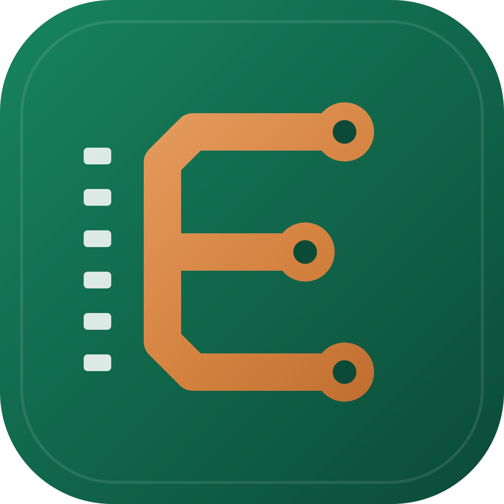
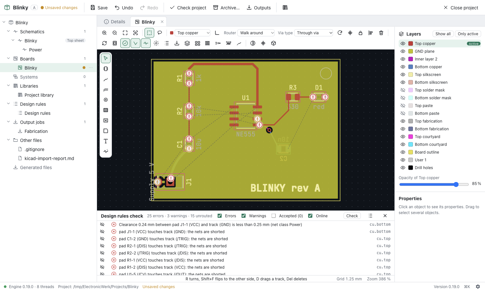

  

# ElectronicWerk

An open-source ECAD suite for beginners and advanced hobbyists. It covers
schematic, symbol, footprint and layout editing, a live 3D view, ERC/DRC,
manufacturing outputs, online part search, KiCad and Eagle exchange and a
full CLI.

> **Status:** early development. Version 0.15 opens ElectronicWerk to other
> tools: **Eagle import**, **KiCad export**, **external autorouters**
> (Specctra DSN/SES, Freerouting), **Gerber files as a reference drawing**
> and **DXF drawings** of the outline and mechanical layers. The GitHub
> integration stays switched off while its sign-in is reviewed: projects
> live on your computer.
> It builds on the assembly assistant, panels, statistics and documentation
> (0.14), scripts and AI agents (0.13), GitHub (0.12), the online part
> libraries (0.11), the 3D view (0.10), manufacturing outputs (0.9), the
> layout editor (0.8), the library editors (0.7), the schematic editor (0.6),
> the base library (0.5), the KiCad import (0.4), the fast 2D view (0.3) and
> projects (0.2).
> See the [roadmap](ROADMAP.md) for milestones and progress.

  

**[Documentation](https://ujap1994.github.io/ElectronicWerk/)** ·
**[Download](https://github.com/Ujap1994/ElectronicWerk/releases/latest)** ·
**[Changelog](CHANGELOG.md)** · **[Contributing](CONTRIBUTING.md)**

## Available now

- An Altium/KiCad-style **project** that holds schematics, PCB, libraries,
  rules and output jobs, with a new-project wizard and templates, a project
  tree, project properties and text variables
- **Never lose work:** unlimited undo/redo, an autosave journal of every
  change, crash recovery and atomic saves
- A fast **2D view** for schematic sheets and boards, drawn by the graphics
  card: smooth pan and zoom (60 fps on a board with 5,000 parts), layers with
  colours and opacity, view from the bottom, click/box/lasso selection and a
  property inspector
- A **schematic editor** in the same view: symbols from the project and base
  libraries, wires with automatic junctions, buses, net, global and
  hierarchical labels, power ports, hierarchical sheets, dragging with
  rubber-banding, copy and paste across sheets, find and replace, net
  highlighting, annotation and an editable inspector; new projects bring
  starter symbols and a guide for a first schematic
- **Library editors** for symbols (pins, units, De Morgan bodies, a pin table
  with bulk edits and pasted pin lists), footprints (all pad kinds and
  shapes, pad arrays, silkscreen, fabrication and courtyard layers, 3D model
  alignment) and components (symbol, footprint, manufacturer, part number,
  suppliers), with **IPC-7351 footprint wizards** (chip, SOIC/QFP, QFN, BGA,
  headers) and KLC-like **library checks**
- A **net navigator**: Ctrl/⌘ + double-click on a net lists every place of it
  on every sheet and jumps there
- A **layout editor**: footprints, **interactive routing** that walks around
  copper of other nets with the clearances of the rules, vias and layer
  changes, dragging tracks, copper **zones** with thermal reliefs, priorities
  and island removal, keep-out areas, board outlines (drawn or **imported
  from DXF**), board presets and a stack-up editor, turning, flipping,
  aligning and an editable inspector
- **Advanced layout:** **push-and-shove** routing and dragging that keeps
  45° bends; **blind, buried and microvias**; **controlled impedance** with
  an impedance calculator (a beginner mode picks the interface, an advanced
  mode sets every value); **differential pairs** routed together;
  **length matching** with exact meanders; **teardrops**; **stitching vias**
  and via fences; **channels** that copy the layout of a repeated sheet;
  **assembly variants** for the outputs
- **Parts from datasheets:** open a part's PDF datasheet and get its symbol,
  an IPC-7351 footprint, a 3D STEP model and the component — pins, packages
  and dimensions are read from the datasheet and shown beside it for
  checking; a part already in a library is named instead; your own AI agent
  can help through MCP (no API key in the app)
- **Enclosure check:** place the STEP files of the enclosure, lid, panels
  and screws around the board in 3D (or make a box that fits) and find
  collisions, too small clearances, mounting holes without bosses and
  connectors without an opening while you lay out; take the board outline
  and height areas from the enclosure; export the whole assembly as STEP
- A **part catalog**: complete parts (symbol, footprint and 3D model) sorted
  into categories — passive parts, semiconductors, ICs by function and
  microcontrollers by vendor, connectors, … — with a choice of the common
  packages for basic parts (0402 … 1206, pin headers, JST, …); place a part
  on the schematic with its package in two clicks
- **Systems of several boards:** a shield on a carrier, a main board with a
  front panel, boards of other projects or reference designs from KiCad and
  Eagle, joined by mating connectors or **cables**; a **connection check
  across the boards** finds swapped and different signals, supplies on
  signal pins and open pins, and renames a signal on every board at once;
  the boards are stacked on their connectors in 3D and checked for
  collisions; a system bill of materials, connection report, wiring lists,
  **harness drawings** and one STEP file
- **Design rules** with net classes, name patterns, board minimums and
  **custom rules** in a small query language (`A.netclass == 'HV' &&
B.netclass != 'HV'`)
- A **design rules check** that runs online while you edit (about 20 ms on a
  500-part board): clearances, shorts, unrouted connections, widths, vias,
  annular rings, holes, board edge, keep-outs, courtyards, silkscreen and
  parity with the schematic, with markers on the board and accepted findings
- **Schematic ↔ board:** update the board from the schematic (new parts,
  footprint and value changes, nets, renamed nets), back annotation of
  designators, values and footprints, and **cross-probing** between sheets
  and board
- An **electrical rules check** with KiCad's configurable pin type matrix,
  unconnected pins, conflicting drivers, missing power and more, a results
  panel that zooms to each problem, and the same results as KiCad on
  imported projects
- **Manufacturing outputs** in **output jobs** (like Altium's OutJobs): one
  click writes **Gerber X2** with net, pad and component attributes and a job
  file, **Excellon** drill files (plated, non-plated, blind and buried, slots),
  a drill map, a configurable **bill of materials** (CSV, XLSX, HTML),
  **pick-and-place** files, **IPC-D-356** and **IPC-2581** netlists, **PDF and
  SVG prints** of schematics, board layers and **assembly drawings**, and a
  ZIP package; **presets** for JLCPCB, PCBWay, AISLER, Eurocircuits and OSH
  Park; the Gerber output is verified pixel by pixel against KiCad 10
- **Panels** made by the output job: copies of the board in rows and
  columns, separated by mouse bites or V-score, with rails, fiducials and
  tooling holes, and a live preview; Gerber, drill and pick-and-place files
  are written for the panel
- **Project documentation:** one self-contained HTML file with the sheets,
  board views, assembly drawings, stack-up, bill of materials, holes and
  **design statistics** (also in the project details and on the CLI)
- An **assembly assistant** for soldering by hand: the parts in groups of
  equal parts, the next ones highlighted on the board, a checklist that is
  saved at once, a workbench mode with large text and its own window for a
  second monitor
- A built-in **Gerber viewer** for Gerber X2/RS-274X and Excellon files from
  any tool
- A **live 3D view** of the board — laminate, copper with its surface finish,
  solder mask, silkscreen and the parts' 3D models — that follows every edit
  at once, in a tab or **in its own window** for a second monitor, with
  camera presets, sections, measuring, screenshots and a selection shared
  with the layout editor; models come from the project, a KiCad installation
  or the base library
- **3D exports:** **STEP** assemblies for mechanical CAD (the board as an exact
  solid with true cylinders for holes, the parts' original STEP models),
  **GLB** and **VRML**, from the 3D view, output jobs or the CLI; part
  placement verified against KiCad 10, the STEP file read back with
  OpenCASCADE in every CI run
- **Exports:** KiCad and CSV netlists, a bill of materials, SVG and a PDF of
  all sheets
- **KiCad import:** KiCad 6 to 10 projects with schematics, hierarchy,
  symbols, board, footprints, zones, rules and project libraries become an
  ElectronicWerk project in one step, with a detailed import report; KiCad
  libraries can be added to a project at any time
- **Eagle import:** Eagle 6 to 9 schematics, boards and libraries (XML)
  become native projects with an import report; nets are kept exactly,
  mirrored parts land on the bottom, `.lbr` libraries go through the
  duplicate check
- **KiCad export:** every project as a KiCad project (KiCad 8 format, opened
  by KiCad 8 to 10) with all sheets, the board, the project libraries and
  the design rules; checked by a round trip and by KiCad itself
- **External autorouters:** the board as a Specctra DSN file for
  Freerouting and others, the routed session (SES) back as one undo step
- **Gerber files as a reference drawing** on user layers, and **DXF
  drawings** of the outline and mechanical layers for mechanical CAD
- **Netlists** from KiCad (`.net`, XML) and CSV: compare them with a board by
  connectivity and apply them
- A **base library** with the KiCad symbols, footprints and 3D models (about
  45,000 entries): full-text search in milliseconds, filters, 2D and 3D
  previews, adding parts to a project; downloaded on demand or built from a
  local KiCad installation
- **Online part libraries:** parts downloaded from **SnapEDA** and **Ultra
  Librarian** (in an isolated provider window or any browser) are imported
  with symbol, footprint and 3D model, and checked against the base library
- **GitHub and source control** (switched off in this version, see
  [GitHub](https://ujap1994.github.io/ElectronicWerk/guide/github)) without
  installing git: projects on GitHub, commit, push, pull, branches, history
  and "Open from GitHub"; sign-in through a GitHub App that may only use the
  repositories you choose, with 8-hour tokens kept in the system keychain, or
  a fine-grained token. Pulls never merge inside a file, so a design is never
  half merged
- **Duplicate detection** independent of the source: exact duplicates are
  merged, near duplicates (pads within 0.05 mm, same mesh in other colours, …)
  are reviewed side by side, with a reproducible report
- An open, **git-friendly file format**: readable JSON, one object per line,
  with schema versions and migrations
- A **CLI** (`ewerk`) for everything: create projects, place parts and
  connect pins by name (`R1.2`, `U1.VCC`), update, place and route boards, run
  the ERC and DRC with exit codes for CI, generate outputs, import KiCad
  projects and libraries, export 3D models and manage the base library;
  scripts in JSON Lines, a JSON-RPC 2.0 session and an **MCP server** so AI
  agents (Claude, Cursor, VS Code, …) can design boards
- A German and English UI, light and dark appearance, a command palette and
  an update notice
- Builds for Windows, macOS and Linux

## Planned highlights

- **Everyday tools:** net colours, a selection filter, select similar and
  edit many at once, a net inspector, groups, custom shortcuts, calculators,
  logos and QR codes
- **Layout construction and routing:** dimensions and a fabrication drawing,
  design blocks, rooms, a creepage check, padstacks, fan-out, bus routing,
  arc tracks and a built-in autorouter
- **Exchange:** ODB++, Gerber back to a board, comparing two versions
- Hardening for version 1.0 on real designs: performance, stability,
  a walkthrough of every workflow and acceptance on real boards

## License

The application code is licensed under the [MIT License](LICENSE). Library
data derived from third-party libraries keeps its original license (for
example, the KiCad libraries are CC-BY-SA 4.0 with a design exception).
