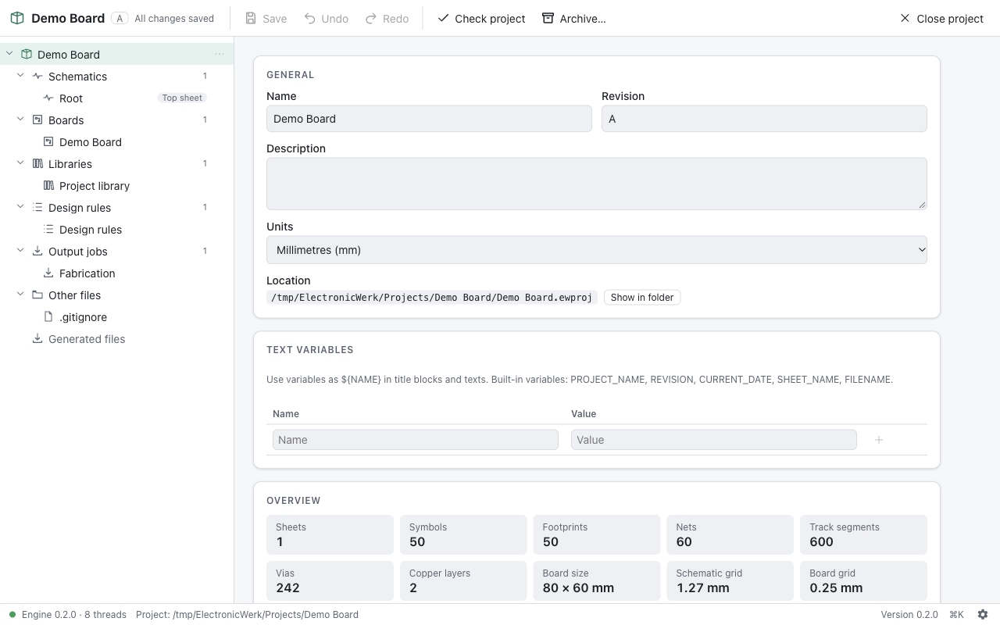

  

# ElectronicWerk

An open-source ECAD suite for beginners and advanced hobbyists. It covers
schematic, symbol, footprint and layout editing, a live 3D view, ERC/DRC,
manufacturing outputs, online part search, GitHub integration and a full CLI.

> **Status:** early development. Version 0.2 adds projects (wizard, project
> tree, native file format, undo, autosave and crash recovery) to the
> application foundation; the editors follow milestone by milestone. See the
> [roadmap](ROADMAP.md) for milestones and progress.

  

**[Documentation](https://ujap1994.github.io/ElectronicWerk/)** ·
**[Download](https://github.com/Ujap1994/ElectronicWerk/releases/latest)** ·
**[Changelog](CHANGELOG.md)** · **[Contributing](CONTRIBUTING.md)**

## Available now

- An Altium/KiCad-style **project** that holds schematics, PCB, libraries,
  rules and output jobs, with a new-project wizard and templates, a project
  tree, project properties and text variables
- **Never lose work:** unlimited undo/redo, an autosave journal of every
  change, crash recovery and atomic saves
- An open, **git-friendly file format**: readable JSON, one object per line,
  with schema versions and migrations
- A **CLI** (`ewerk`) to create, inspect, check and archive projects, and a
  JSON-RPC session for scripts and AI agents
- A German and English UI, light and dark appearance, a command palette and
  an update notice
- Builds for Windows, macOS and Linux

## Planned highlights

- **KiCad import** (projects and libraries) and open standard formats
  (netlists, DXF, Gerber, STEP, …)
- A **unified base library** with deduplication, and **online part search**
- A **live 3D view**, optionally in its own window
- **ERC, DRC** and a rule system
- Manufacturing outputs: Gerber X2, Excellon, BOM, pick-and-place, PDF, STEP
- **GitHub integration**: save a project straight to a new or existing
  repository
- A complete CLI and MCP server for scripting and AI agents
- An **assembly assistant**

## License

The application code is licensed under the [MIT License](LICENSE). Library
data derived from third-party libraries keeps its original license (for
example, the KiCad libraries are CC-BY-SA 4.0 with a design exception).
