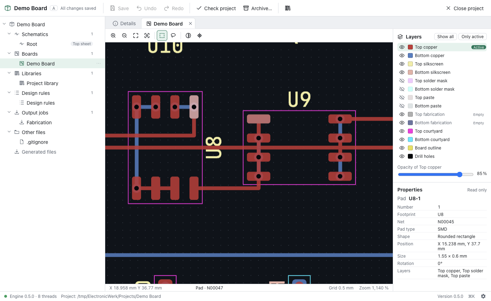

  

# ElectronicWerk

An open-source ECAD suite for beginners and advanced hobbyists. It covers
schematic, symbol, footprint and layout editing, a live 3D view, ERC/DRC,
manufacturing outputs, online part search, GitHub integration and a full CLI.

> **Status:** early development. Version 0.5 adds the base library: the
> KiCad symbols, footprints and 3D models in one searchable place, with 2D and
> 3D previews and duplicate detection. It builds on the KiCad import (0.4), the
> fast 2D view (0.3) and projects (0.2). The editors follow milestone by
> milestone. See the [roadmap](ROADMAP.md) for milestones and progress.

  

**[Documentation](https://ujap1994.github.io/ElectronicWerk/)** ·
**[Download](https://github.com/Ujap1994/ElectronicWerk/releases/latest)** ·
**[Changelog](CHANGELOG.md)** · **[Contributing](CONTRIBUTING.md)**

## Available now

- An Altium/KiCad-style **project** that holds schematics, PCB, libraries,
  rules and output jobs, with a new-project wizard and templates, a project
  tree, project properties and text variables
- **Never lose work:** unlimited undo/redo, an autosave journal of every
  change, crash recovery and atomic saves
- A fast **2D view** for schematic sheets and boards, drawn by the graphics
  card: smooth pan and zoom (60 fps on a board with 5,000 parts), layers with
  colours and opacity, view from the bottom, click/box/lasso selection and a
  property inspector
- A **schematic editor** in the same view: symbols from the project and base
  libraries, wires with automatic junctions, buses, net, global and
  hierarchical labels, power ports, hierarchical sheets, dragging with
  rubber-banding, copy and paste across sheets, find and replace, net
  highlighting, annotation and an editable inspector; new projects bring
  starter symbols and a guide for a first schematic
- An **electrical rules check** with KiCad's configurable pin type matrix,
  unconnected pins, conflicting drivers, missing power and more, a results
  panel that zooms to each problem, and the same results as KiCad on
  imported projects
- **Exports:** KiCad and CSV netlists, a bill of materials, SVG and a PDF of
  all sheets
- **KiCad import:** KiCad 6 to 10 projects with schematics, hierarchy,
  symbols, board, footprints, zones, rules and project libraries become an
  ElectronicWerk project in one step, with a detailed import report; KiCad
  libraries can be added to a project at any time
- **Netlists** from KiCad (`.net`, XML) and CSV: compare them with a board by
  connectivity and apply them
- A **base library** with the KiCad symbols, footprints and 3D models (about
  45,000 entries): full-text search in milliseconds, filters, 2D and 3D
  previews, adding parts to a project; downloaded on demand or built from a
  local KiCad installation
- **Duplicate detection** independent of the source: exact duplicates are
  merged, near duplicates (pads within 0.05 mm, same mesh in other colours, …)
  are reviewed side by side, with a reproducible report
- An open, **git-friendly file format**: readable JSON, one object per line,
  with schema versions and migrations
- A **CLI** (`ewerk`) to create, inspect, check and archive projects, import
  KiCad projects, libraries and netlists, build, search and distribute the
  base library, and a JSON-RPC session for scripts and AI agents
- A German and English UI, light and dark appearance, a command palette and
  an update notice
- Builds for Windows, macOS and Linux

## Planned highlights

- Open standard formats (DXF, Gerber, STEP, …)
- **Online part search** that plugs into the base library and its
  deduplication
- A **live 3D view**, optionally in its own window
- **DRC** and a rule system for the layout
- Manufacturing outputs: Gerber X2, Excellon, BOM, pick-and-place, PDF, STEP
- **GitHub integration**: save a project straight to a new or existing
  repository
- A complete CLI and MCP server for scripting and AI agents
- An **assembly assistant**

## License

The application code is licensed under the [MIT License](LICENSE). Library
data derived from third-party libraries keeps its original license (for
example, the KiCad libraries are CC-BY-SA 4.0 with a design exception).
