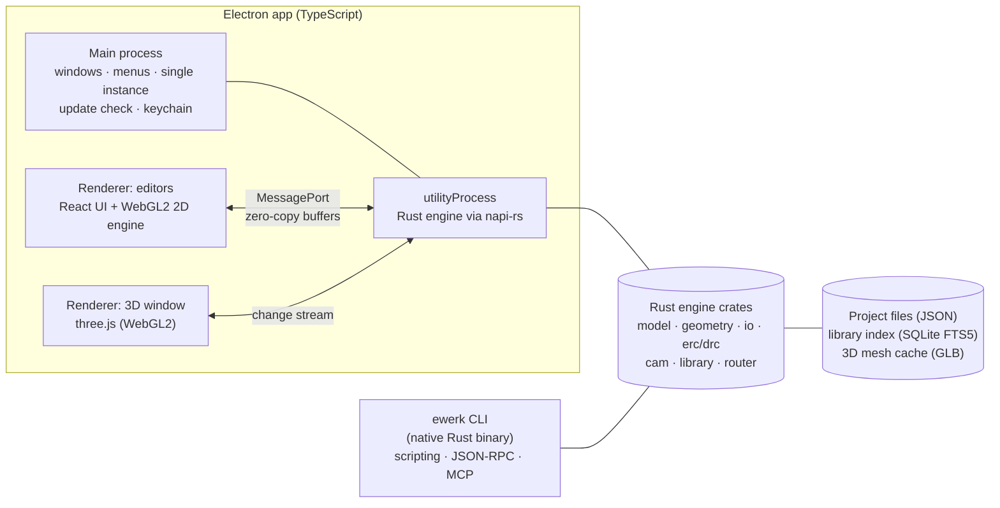

# ElectronicWerk Roadmap

> **Status:** v0.16 (2026-11-13). M0 to M10 are complete (releases v0.1.0 to
> v0.11.0; M0, M1 and M3 accepted by the maintainer); M11 is next.
> This roadmap is a living document. It **must** be updated with every feature
> (requirement D5). Every change to it is listed in the
> [roadmap changelog](#13-roadmap-changelog).

---

## Table of contents

1. [Vision](#1-vision)
2. [Guiding principles](#2-guiding-principles)
3. [Project concept](#3-project-concept)
4. [Architecture](#4-architecture)
5. [Quality gates and Definition of Done](#5-quality-gates-and-definition-of-done)
6. [Performance budgets](#6-performance-budgets)
7. [Releases and packaging](#7-releases-and-packaging)
8. [Milestone overview](#8-milestone-overview)
9. [Milestone details](#9-milestone-details)
10. [File format matrix](#10-file-format-matrix)
11. [Requirements traceability](#11-requirements-traceability)
12. [Risks, open decisions and deferred items](#12-risks-open-decisions-and-deferred-items)
13. [Roadmap changelog](#13-roadmap-changelog)

---

## 1. Vision

ElectronicWerk is an open-source ECAD suite (MIT license) for beginners and
advanced hobbyists. It takes inspiration from the workflow and feature set of
Altium Designer, KiCad, DipTrace and Eagle, but everything is written from
scratch: no copied code, assets or file formats.

It covers the whole path from idea to manufactured board:

- **Project:** one project holds schematics, PCB, libraries, rules and outputs
  (as in Altium Designer and KiCad).
- **Design:** schematic, symbol, footprint and layout editors, plus a live 3D view.
- **Verify:** ERC, DRC and a design-rule system.
- **Manufacture:** Gerber X2, Excellon, BOM, pick-and-place, PDF, STEP and more.
- **Library:** a unified base library, online part search, deduplication.
- **Collaborate:** projects saved straight to GitHub.
- **Automate:** a full CLI, so scripts and AI agents can create schematics and
  boards from a terminal.
- **Assemble:** an interactive assembly assistant.

## 2. Guiding principles

| #   | Principle                       | What it means in practice                                                                                                  |
| --- | ------------------------------- | -------------------------------------------------------------------------------------------------------------------------- |
| 1   | **Performance is a feature**    | Measurable budgets (section 6) checked by benchmarks in CI. A regression fails the build.                                  |
| 2   | **Never lose work**             | Crash-isolated engine, autosave journal, crash recovery, atomic saves.                                                     |
| 3   | **Usability is mandatory**      | Beginner-friendly defaults, guided workflows, command palette, consistent shortcuts, undo for everything, contextual help. |
| 4   | **One engine, many front-ends** | Every action is an engine command. GUI, CLI, AI/MCP and tests all use the same API, so CLI parity comes for free.          |
| 5   | **Open, git-friendly formats**  | Text-based, deterministic and diff-friendly files with a schema version and automatic migrations.                          |
| 6   | **Quality from day one**        | 100 % lint-clean, tests on Windows/macOS/Linux, and documentation with screenshots for every feature.                      |
| 7   | **Privacy**                     | Anonymized docs and examples, credentials in the OS keychain, no telemetry.                                                |
| 8   | **Extensible**                  | Modular Rust crates and a versioned command API, ready for plugins after 1.0.                                              |

## 3. Project concept

As in Altium Designer and KiCad, **everything belongs to a project**. A project
is a folder with a manifest file and typed documents:

```text
MyBoard/
├── MyBoard.ewproj            # Project manifest: metadata, document list, settings, variables
├── schematics/
│   ├── root.ewsch            # Top sheet (hierarchical design)
│   └── power.ewsch           # Sub-sheets, multi-sheet and hierarchical
├── pcb/
│   └── MyBoard.ewpcb         # Board: stack-up, placement, routing, zones
├── rules/
│   └── design.ewrules        # Net classes, clearances, rule queries
├── library/                  # Project library (symbols, footprints, 3D, components)
├── outputs/
│   ├── fabrication.ewout     # Output job: Gerber, drill, BOM, CPL, PDF, STEP …
│   └── generated/            # Generated files (git-ignored by default)
└── .ewerk/                   # Local state: autosave journal, caches (never committed)
```

- **Project tree panel** (like Altium's _Projects_ panel): schematics, PCB,
  libraries, rules, output jobs, generated files and git status in one tree.
- **Project-wide data:** net classes, parameters and text variables (for
  example `${PROJECT_NAME}` and `${REVISION}` in title blocks), annotation,
  cross-probing, and engineering change orders (schematic ↔ PCB sync).
- **New-project wizard:** name, location (**local** or **GitHub**, see M11),
  template (for example _Empty_, _2-layer 100×100 mm_, _Arduino-style shield_)
  and board defaults.
- **Imported projects** (KiCad, netlists) always become a new native project.
  The original files are never changed.
- **Future-proof:** the manifest holds a list of documents, so later releases
  can add several boards per project, variants and harness documents without a
  format break.
- **Archive and copy:** _Save as_, _Save copy_ and _Archive project (.zip)_.

## 4. Architecture

> Proposed here and recorded as **ADR-0001** in M0. Architecture Decision
> Records live in `docs/adr/`.



| Layer                   | Technology                        | Responsibility                                                                                                                                                    |
| ----------------------- | --------------------------------- | ----------------------------------------------------------------------------------------------------------------------------------------------------------------- |
| Desktop shell           | Electron, TypeScript              | Windows (including a detachable 3D window), menus, single-instance lock, secure storage (`safeStorage`), update check. Closing the window quits the app cleanly.  |
| UI                      | React, TypeScript, Vite           | Panels, dialogs, property inspectors, command palette, i18n (German/English). Runs in a sandboxed renderer with `contextIsolation` and without `nodeIntegration`. |
| 2D rendering            | Custom WebGL2 engine (TypeScript) | Instanced rendering, layer compositing, level of detail, viewport culling, SDF text. Shared by all 2D editors.                                                    |
| 3D rendering            | three.js (WebGL2)                 | Board and component meshes, live updates from the engine change stream.                                                                                           |
| Engine                  | Rust workspace                    | Data model, commands, undo/redo, geometry, import/export, ERC/DRC, CAM, library, router. Multi-threaded (rayon). Runs in a crash-isolated `utilityProcess`.       |
| CLI                     | Rust binary `ewerk`               | Same engine crates. Batch commands, JSON-RPC server and MCP server for AI agents.                                                                                 |
| C++ (only where needed) | OpenCASCADE                       | STEP tessellation (first through the `occt-import-js` WASM build, later natively) and STEP assembly export.                                                       |
| Storage                 | JSON, SQLite FTS5, GLB            | Deterministic project files, a fast library search index, a cached 3D mesh per model.                                                                             |

### Core data model decisions

- Coordinates are integer **nanometres** (`i64`). There are no rounding errors
  and no size limits that matter.
- Every object has a stable **UUID**. Diffs and git merges stay readable.
- Every edit is a **transaction** (command pattern). This gives undo/redo,
  autosave journaling and change sets.
- Change sets are **streamed** to every view (2D editors, 3D window, panels).
  This is what makes the live 3D view and cross-probing possible.
- The file format has a **schema version** and migrations, so newer releases
  always open older projects.

## 5. Quality gates and Definition of Done

### Lint: 100 %, zero warnings (T2)

| Area         | Tools and settings                                                                                                                             |
| ------------ | ---------------------------------------------------------------------------------------------------------------------------------------------- |
| TypeScript   | `tsc` in strict mode with all strict flags; ESLint (`typescript-eslint` _strict-type-checked_ + _stylistic_) with `--max-warnings 0`; Prettier |
| Suppressions | `eslint-comments/require-description`: no unexplained `eslint-disable`                                                                         |
| i18n         | A check for hard-coded UI strings, plus a key-parity test between German and English                                                           |
| CSS          | Stylelint                                                                                                                                      |
| Rust         | `rustfmt`; `clippy` with `-D warnings` and `clippy::pedantic`; `cargo-deny` (licenses, advisories, duplicate dependencies)                     |
| Docs         | markdownlint, link checker                                                                                                                     |
| CI           | actionlint for workflows                                                                                                                       |
| Commits      | commitlint (Conventional Commits). The changelog and release notes are generated from these.                                                   |
| Local        | lefthook pre-commit hooks run the same checks                                                                                                  |

### Tests

| Level        | Tools                          | Scope                                                                               |
| ------------ | ------------------------------ | ----------------------------------------------------------------------------------- |
| Unit         | `cargo test`, proptest, Vitest | Engine crates, UI logic, i18n, update checker                                       |
| Integration  | Vitest + engine                | IPC bridge, commands, importer → model → exporter                                   |
| Golden files | `cargo test` + snapshots       | Importers and exporters (Gerber, Excellon, BOM …) compared against reference output |
| End-to-end   | Playwright for Electron        | Real UI workflows on Windows, macOS and Linux                                       |
| Performance  | criterion, Playwright traces   | The budgets in section 6. A regression of more than 10 % fails CI.                  |

Coverage targets: engine ≥ 90 % lines, UI logic ≥ 80 % lines.

### Definition of Done (for every feature)

1. Implemented as an engine command, with a CLI command where it makes sense.
2. Unit, integration and E2E tests are green on Windows, macOS and Linux.
3. 100 % lint-clean, with no new suppressions.
4. All UI strings exist in German and English.
5. A **documentation page** with screenshots (generated automatically from
   anonymized demo projects) and examples.
6. CHANGELOG entry and **roadmap update**.
7. Tested by the agent, and by the maintainer where needed, then commit, CI
   and release (D3).

## 6. Performance budgets

Reference designs are generated synthetically, so they are reproducible and
anonymous:

| Name   | Size                                                       |
| ------ | ---------------------------------------------------------- |
| **S**  | 50 parts, 2 layers                                         |
| **M**  | 500 parts, 4 layers                                        |
| **L**  | 5,000 parts, 10,000 nets, 200,000 track segments, 8 layers |
| **XL** | 20,000 parts (stress test)                                 |

| Metric                                            | Budget        |
| ------------------------------------------------- | ------------- |
| Pan/zoom frame rate (L, mid-range integrated GPU) | ≥ 60 fps      |
| Input to visual feedback (hover, drag, route)     | < 16 ms       |
| App start until the start screen                  | < 2 s         |
| Open project (L) / save project (L)               | < 3 s / < 1 s |
| Incremental DRC after an edit (L)                 | < 100 ms      |
| Full DRC (L)                                      | < 10 s        |
| 3D update after a layout edit                     | < 250 ms      |
| 3D frame rate with all component models (L)       | ≥ 30 fps      |
| Memory (L)                                        | < 1.5 GB      |

## 7. Releases and packaging

- **Versioning:** SemVer, with `0.x` until 1.0. Every tested feature produces a
  release (D3). Release notes come from the CHANGELOG.
- **Automated** through GitHub Actions (build → test → package → publish), with
  a `SHA256SUMS` file for every release.
- **Unsigned builds** (open source): the docs explain how to open the app
  despite macOS Gatekeeper and Windows SmartScreen.
- **In-app update notice** (T7): the app compares its version against GitHub
  Releases and shows the release notes. Users can _skip this version_ or open
  the download page. It never installs anything on its own.

| Platform | Packages                                                                                              | Architectures                                 |
| -------- | ----------------------------------------------------------------------------------------------------- | --------------------------------------------- |
| Windows  | NSIS installer, portable `.exe`                                                                       | x64, arm64                                    |
| macOS    | `.dmg`, `.zip`                                                                                        | Universal, Apple Silicon (arm64), Intel (x64) |
| Linux    | AppImage, `.deb` (Ubuntu, Mint), `.rpm` (Fedora), `.pacman` (Arch, CachyOS), Snap, Flatpak, `.tar.gz` | x64, arm64                                    |

## 8. Milestone overview

**Effort unit:** 1 session (S) ≈ 4 hours of focused agent work, including
implementation, tests, documentation and CI. These estimates cover the agent's
own work only. Maintainer test cycles and feedback come on top. Status values:
⬜ planned · 🟦 in progress · ✅ done.

| ID  | Milestone                                             | Release | Requirements      | Effort          | Status |
| --- | ----------------------------------------------------- | ------- | ----------------- | --------------- | ------ |
| M0  | Foundation and delivery pipeline                      | v0.1.0  | T1, T2, T7, D1–D5 | 6–8 S           | ✅     |
| M1  | Project system, data model, native file format        | v0.2.0  | F3, T3, T6        | 6–8 S           | ✅     |
| M2  | 2D rendering engine and read-only viewer              | v0.3.0  | T3, T4, T5        | 7–10 S          | ✅     |
| M3  | KiCad import (projects and libraries), netlist import | v0.4.0  | F3                | 6–9 S           | ✅     |
| M4  | Unified base library and library manager              | v0.5.0  | F2                | 5–8 S           | ✅     |
| M5  | Schematic editor and ERC                              | v0.6.0  | F4, F10           | 12–18 S         | ✅     |
| M6  | Symbol editor and footprint editor                    | v0.7.0  | F5, F6            | 8–12 S          | ✅     |
| M7  | Layout editor, DRC, rules, schematic ↔ PCB sync       | v0.8.0  | F7, F10           | 16–24 S         | ✅     |
| M8  | Manufacturing outputs and output jobs                 | v0.9.0  | F10               | 7–10 S          | ✅     |
| M9  | Live 3D view and STEP export                          | v0.10.0 | F8                | 7–10 S          | ✅     |
| M10 | Online part libraries: SnapEDA, Ultra Librarian       | v0.11.0 | F1                | 6–9 S           | ✅     |
| M11 | GitHub integration                                    | v0.12.0 | F9                | 4–6 S           | ⬜     |
| M12 | CLI and AI automation (complete)                      | v0.13.0 | F12               | 4–6 S           | ⬜     |
| M13 | Assembly assistant and extras                         | v0.14.0 | F11               | 4–6 S           | ⬜     |
| M14 | Interoperability: further open formats                | v0.15.0 | F3                | 5–8 S           | ⬜     |
| M15 | Advanced layout                                       | v0.16.0 | F7                | 12–20 S         | ⬜     |
| M16 | Hardening, UX audit, final docs and videos            | v1.0.0  | T3–T5, D1         | 6–10 S          | ⬜     |
|     | **Total to v1.0**                                     |         |                   | **≈ 120–180 S** |        |

**Stages:**

- After **M3**: KiCad projects can be opened and viewed.
- After **M8** (≈ 75–105 S): the full workflow schematic → layout → Gerber
  works.
- **M16**: v1.0.0.

Expected code size by v1.0: about 150,000–250,000 lines (Rust + TypeScript,
including tests).

## 9. Milestone details

### M0 — Foundation and delivery pipeline (v0.1.0, 6–8 S)

**Goal:** an empty but complete, secure and tested app shell, built and
released automatically for every platform.

- Monorepo: `crates/` (Rust engine, CLI, napi bridge), `apps/desktop`
  (Electron), `packages/` (UI, i18n, protocol types), `docs/` (documentation
  site), `assets/icon/`, `tests/e2e/`, `fixtures/` (synthetic and anonymized).
- Electron shell with secure defaults (`contextIsolation`, `sandbox`, no
  `nodeIntegration`, strict CSP, navigation and permission lock). Single
  instance; closing the window quits the app on every OS.
- Rust engine in a `utilityProcess` through napi-rs, a typed RPC over
  MessagePort, and crash detection and restart. The `ewerk` CLI skeleton
  (`--version`, `info`).
- App shell UI: start screen (new/open/recent), settings (language, theme,
  updates), status bar, command palette skeleton, light and dark themes.
- i18n: German and English, defaulting to the system language and switchable
  at runtime.
- Project icon as an SVG master. A script generates PNG, ICO and ICNS, and the
  icon is used for the window, Dock/taskbar, installer, favicon, README, docs
  and release page.
- Update check (T7): GitHub Releases API, version comparison, release notes in
  a dialog, a _Skip this version_ checkbox, _Remind me later_, _Open download
  page_. Works offline without errors.
- All lint gates (section 5) and the test stack (Vitest, `cargo test`,
  Playwright for Electron) on a CI matrix for Windows, macOS and Linux.
- Release workflow for every package in section 7, with a smoke test of the
  packaged app.
- Documentation site (VitePress on GitHub Pages) with an automated screenshot
  pipeline (Playwright). First pages: Installation (per OS, including the
  unsigned-app notes), Getting started, Settings, Language, Updates.
- Repository files: README, CHANGELOG, CONTRIBUTING, LICENSE, ADR-0001
  (architecture), issue and PR templates.

**Progress (completed 2026-11-07):**

- [x] Monorepo with Rust workspace (`ew-core`, `ew-cli`, `ew-node`) and the
      Electron app (`apps/desktop`)
- [x] Secure Electron shell: sandbox, context isolation, CSP, `app://`
      scheme, IPC sender checks, single instance, window close quits the app
- [x] Rust engine in a crash-isolated `utilityProcess` with automatic restart
      and a direct MessagePort channel (ADR-0001)
- [x] `ewerk` CLI (`info`, `methods`, `call`)
- [x] Start screen, status bar, settings dialog (language, appearance,
      updates), command palette
- [x] German and English UI with a type-checked key parity and a lint rule
      against hard-coded UI text
- [x] Lint gates with zero warnings, plus cargo-deny and actionlint in CI
- [x] Test stack: Rust, Vitest, Playwright for Electron; CI on
      Windows/macOS/Linux
- [x] Project icon (SVG master and generated formats)
- [x] Update check with release notes and "skip this version"
- [x] Release workflow for every package (native runners for Windows x64/arm64,
      macOS and Linux x64/arm64; smoke test of every packaged app)
- [x] Documentation site with automated screenshots
      (<https://ujap1994.github.io/ElectronicWerk/>)
- [x] Release v0.1.0

**Acceptance:** v0.1.0 is published with every package. The app starts, the
language switches, the update notice works, E2E tests are green on all three
operating systems, and the docs site is online.

### M1 — Project system, data model, native file format (v0.2.0, 6–8 S)

- Engine data model: project, documents, sheets (hierarchical), symbols,
  components, nets, footprints, pads, board stack-up, layers, tracks, vias,
  zones, texts, parameters and variables.
- Project concept as in section 3: manifest, document list, project tree
  panel, new-project wizard (local; GitHub follows in M11), templates.
- Transactions and command system: undo/redo (unlimited, with memory limits),
  change-set streaming, autosave journal, crash recovery, atomic saves.
- Native JSON format with deterministic, sorted output, a schema version and a
  migration framework.
- Generator for synthetic reference designs (S/M/L/XL) and the performance
  benchmark harness.
- CLI: `ewerk project new|info|validate`.

**Acceptance:** projects can be created, saved, reopened and archived. A kill
test proves crash recovery. A round-trip property test covers saving and
loading.

**Progress (completed 2026-11-08):**

- [x] Rust crates `ew-model` (data model), `ew-format` (file format) and
      `ew-synth` (synthetic designs); sessions, transactions, history and
      journal in `ew-core` (ADR-0002)
- [x] Data model: project manifest, schematic sheets (hierarchy, symbols,
      wires, buses, labels, power ports, sheet symbols), library (symbols,
      footprints, 3D model references), board (stack-up, nets, footprints,
      pads, tracks and arcs, vias, zones, texts, graphics), rules (constraints,
      net classes), output jobs, text variables
- [x] Native JSON format: deterministic layout with one object per line,
      schema version, migration framework with backups, atomic multi-file
      saves, validation (`project.validate`), ZIP archives
- [x] Transactions with unlimited undo/redo (memory limit 256 MB),
      change-set events to every window, autosave journal, crash recovery
      (engine restart and app crash), dirty tracking per document
- [x] New-project wizard (local storage; GitHub follows in M11) with five
      templates, project tree, project and document properties, recent
      projects, Save As/Copy, Archive, close prompts, `.ewproj` file
      association
- [x] CLI: `ewerk project new|info|validate|archive|upgrade|templates`,
      `ewerk rpc`, `ewerk synth`, `ewerk bench`
- [x] Synthetic S/M/L/XL designs, criterion benchmarks and the open/save
      budgets in CI (L: open ≈ 0.14 s, save ≈ 0.31 s locally)
- [x] Tests: round-trip and layout property tests, undo/journal property
      tests, a SIGKILL test of a running `ewerk rpc` session, 8 new end-to-end
      tests (wizard, editing, tree, close prompts, engine crash, app kill,
      open/save as/copy/archive)
- [x] Documentation: Projects, Project tree and properties, Undo/autosave and
      recovery, File format, Benchmarks, CLI and Engine API references
- [x] Release v0.2.0
- [x] Tested and accepted by the maintainer (2026-11-08)

### M2 — 2D rendering engine and read-only viewer (v0.3.0, 7–10 S)

- WebGL2 engine: instanced primitives (lines, arcs, polygons, pads, vias),
  layer compositing with colours and opacity, grid, SDF text, level of detail
  and culling.
- Interaction basics: smooth pan and zoom (mouse, trackpad, keyboard), hover,
  selection (click, box, lasso), hit-testing with a spatial index (R-tree).
- Layer panel, property inspector (read-only) and the project tree connected
  to the viewer.
- Synthetic L/XL boards prove the budgets in section 6.

**Acceptance:** an L design pans and zooms at ≥ 60 fps. The benchmarks run in
CI.

**Progress (completed 2026-11-08):**

- [x] Crate `ew-scene` and engine methods `view.scene` / `view.object`: sheets
      and boards become instanced primitives (segments, arcs, discs/rings,
      rounded rectangles, triangle meshes) and texts in one binary buffer,
      Z-order sorted with chunk boxes; an object table for selection
      (ADR-0003)
- [x] WebGL2 engine: SDF primitives with exact shapes, MSAA with
      alpha-to-coverage, per-layer opacity through the constant blend colour
      and a per-layer depth value, SDF text (bundled JetBrains Mono), adaptive
      dot grid, chunk culling, text level of detail, selection/hover flag
      texture
- [x] Interaction: animated zoom around the cursor (wheel, pinch, keys),
      pan (drag, trackpad, keys), fit, zoom to selection, view from the
      bottom; hover, click, box (window/crossing) and lasso selection with a
      Flatbush R-tree and exact hit tests
- [x] Layer panel (visibility, active layer, opacity, highlight active
      layer), Display panel for sheets, read-only inspector, document tabs
      opened from the project tree, view memory per document, live reload
      after every change
- [x] Budgets: L board scene ≈ 40 ms in Rust (CI budget 0.5 s); L board opens
      in the app in 0.2 s and pans/zooms at 60 fps with ≈ 0.2 ms CPU per frame
      on an Apple M3; XL (2.3 million primitives) also 60 fps. Viewer
      benchmark job in CI (macOS)
- [x] Tests: Rust unit and engine tests, Vitest unit tests (camera, culling,
      layers, text layout), an integration test against the native engine,
      3 end-to-end tests and the benchmark test
- [x] Documentation: Viewing sheets and boards, keyboard shortcuts,
      troubleshooting, Engine API (`view.*`), benchmarks, architecture,
      ADR-0003
- [x] Release v0.3.0

### M3 — KiCad import and netlist import (v0.4.0, 6–9 S)

- Fast S-expression parser (Rust, streaming) for the current KiCad 10 format,
  plus older format versions as far as practical.
- Import of symbols (`.kicad_sym`, `.kicad_symdir`), footprints
  (`.kicad_mod`, `.pretty`), schematics (hierarchical, multi-sheet), PCB
  (`.kicad_pcb`, inner layers, zones, vias, rules), project files
  (`.kicad_pro`, `.kicad_dru`, library tables) and 3D model references.
- **Import as a new project:** a KiCad project becomes a native ElectronicWerk
  project with a detailed import report (warnings and anything that could not
  be mapped).
- Netlist import: KiCad netlist (`.net`), generic CSV/XML netlists. Other open
  netlist formats are added if needed.
- Tests: synthetic KiCad fixtures in CI, plus regression tests against private
  sample projects that only run locally and never enter the repository.

**Acceptance:** a 4-layer, multi-sheet KiCad 10 project imports without errors
and matches the original visually and electrically (net comparison).

**Progress (completed 2026-11-08):**

- [x] Crate `ew-kicad` (ADR-0004): a non-recursive, borrowing S-expression
      parser; KiCad 6 to 10 (net names in KiCad 10, net codes before; layers
      mapped by name; `hide` in both styles)
- [x] Import of schematics (hierarchy, symbols with KiCad's transforms and
      field placement, wires, buses, labels, junctions, no-connects, texts,
      graphics, title blocks), symbol libraries (units, pins, pin text,
      derived symbols), boards (stackup, footprints with every pad shape,
      tracks, arcs, vias, zones with filled areas, keep-outs, outline),
      project files (net classes, assignments, constraints, text variables),
      library tables (`${KIPRJMOD}`) and 3D model references; symbols and
      footprints linked as components
- [x] Import as a new project with a detailed report (21 codes, severities,
      counts), also written as `kicad-import-report.md`; `.kicad_dru` custom
      rules, dimensions, text boxes, images and alternate body styles are
      reported
- [x] KiCad library import into a project library (`.kicad_sym`,
      `.kicad_symdir`, `.pretty`, `.kicad_mod`)
- [x] Netlists: KiCad `.net`, KiCad XML and CSV; comparison by connectivity,
      differences, apply as one undoable step
- [x] UI: import card on the start screen, menu and palette commands, import
      dialog, report dialog, netlist dialog, context menus in the project
      tree; CLI `ewerk import kicad|library|netlist`; engine methods
      `import.*`
- [x] View: solid zone fills, hidden pin names and numbers, upright texts
- [x] Tests: synthetic KiCad 10 project (generated, 4 layers, two sheets, a
      bottom-side part, a filled zone, netlists in three formats) in unit,
      engine, CLI and end-to-end tests; local-only regression tests against a
      real project and the official KiCad libraries
- [x] Acceptance checked locally: a real 4-layer, multi-sheet KiCad 10
      project imports with 0 errors in 0.08 s, 480 of 480 nets match KiCad's
      netlist, and the sheets and the board were checked against KiCad's PDF
      plots; all official KiCad libraries (22,916 symbols, 15,470 footprints)
      read in 5.6 s without errors
- [x] Documentation: Importing KiCad projects, Netlists, CLI and Engine API
      references, file format, benchmarks, architecture, ADR-0004
- [x] Release v0.4.0
- [x] Tested and accepted by the maintainer (2026-11-09)

### M4 — Unified base library and library manager (v0.5.0, 5–8 S)

- Library index: SQLite with FTS5 full-text search (name, value, package,
  manufacturer part number, keywords, parameters).
- Ingest of the KiCad base libraries (symbols, footprints, 3D models).
- **Deduplication engine (independent of the source):** a normalized geometry
  hash for footprints (pads, shapes, sizes, after normalizing origin, rotation
  and units), a pin signature for symbols, and a content hash and bounding box
  for 3D models. Results are classed as exact duplicate, near duplicate (within
  tolerance) or alias. A merge report and a review UI handle uncertain cases.
  New sources (online parts in M10, further formats in M14) plug into the same
  engine.
- 3D mesh cache: STEP/WRL → GLB, tessellated once and then reused.
- Library manager UI: a virtualized list (more than 100,000 entries), filters,
  and previews of the symbol, footprint and 3D model.
- License handling: the KiCad libraries are CC-BY-SA 4.0 with a design
  exception. The merged library is published separately under that license,
  with attribution. The app code stays MIT.
- Distribution of large data (more than 3 GB of 3D models): library packs
  downloaded on demand instead of bundled in the installer.

**Acceptance:** a search over the whole base library answers in < 50 ms. The
dedup report is reproducible.

**Progress (completed 2026-11-08):**

- [x] Crate `ew-library` (ADR-0005): SQLite index with FTS5 (name, library,
      description, keywords, value, package, part number, manufacturer,
      parameters), BM25 ranking with field weights, prefix phrases, filters
      and facets; definitions stored compressed without ids
- [x] Ingest of the KiCad libraries (symbols, footprints, 3D models), in
      parallel and in a stable order; local KiCad installations are detected
      on Windows, macOS and Linux
- [x] Deduplication engine, independent of the source: canonical
      fingerprints (footprints: pads and graphics, centred and turned, 1 µm;
      symbols: pins and body; meshes: sorted triangles with and without
      colours); exact duplicates, near duplicates (pads within 0.05 mm, same
      pads with other graphics, same name with another drawing, same mesh in
      other colours, same size and triangle count) and aliases; decisions in
      `decisions.json`; reproducible JSON and Markdown report
- [x] 3D mesh cache: STEP → GLB with OpenCASCADE (`occt-import-js`,
      WebAssembly) — in bulk with `scripts/tessellate.ts` (7,257 models in
      7.4 min on eight cores, no failures) and on demand in a worker thread of
      the engine host; GLB files named by content hash
- [x] Library manager: search, filters, virtualized list, 2D previews
      (symbols, footprints), 3D previews (models, footprints with their model,
      three.js), details, duplicates review side by side, adding parts to the
      project library, setup (download or local build) with progress
- [x] License handling: the library is published separately as a release
      `library-kicad-<version>-r<run>` with `LICENSE.md` (CC-BY-SA 4.0 with the
      KiCad libraries exception, source and changes); the app stays MIT
- [x] Distribution: packs (index ~42 MB, 105 mesh packs ~220 MB) with a
      manifest and SHA-256 checksums; the index is downloaded at setup, mesh
      packs when a model is first shown; **Library** workflow builds the
      packs from the official KiCad libraries on GitLab
- [x] CLI `ewerk library build|info|search|duplicates|pack|install`; engine
      methods `library.*`
- [x] Acceptance: every search over the KiCad 10 libraries (45,643 entries)
      answers in 0.1–15 ms; two builds give byte-identical reports (local
      test against the real libraries, CI test with the synthetic library);
      CI search budget on 50,000 entries
- [x] Tests: Rust unit and integration tests (synthetic library with every
      duplicate class), engine tests, Vitest (manifests, GLB writer), two
      end-to-end tests (local build with on-demand tessellation, download of
      packs), screenshots
- [x] Documentation: The base library, Duplicates, Building the base library,
      CLI and Engine API references, benchmarks, architecture, ADR-0005
- [x] Release v0.5.0

### M5 — Schematic editor and ERC (v0.6.0, 12–18 S)

- Place, move, rotate and mirror components; wires, buses, junctions, net
  labels, global and hierarchical labels, power ports, no-connect flags.
- Hierarchical sheets and multi-sheet designs, sheet symbols and ports.
- Annotation (automatic and manual), component parameters, text variables,
  title blocks.
- Smart editing: drag with rubber-banding, auto-junctions, copy and paste
  across sheets, find and replace, net highlighting.
- ERC: pin type matrix (configurable), unconnected pins, conflicting drivers,
  missing power and more. Results panel with zoom-to-issue.
- Beginner aids: guided first schematic, tooltips, a snap and grid assistant.
- Exports: PDF/SVG print, netlist, BOM (preliminary).

**Progress (completed 2026-11-09):**

- [x] Crate `ew-schematic` (ADR-0006): connectivity of all sheets and sheet
      placements with KiCad's rules and net names (480 of 480 connected nets
      of a real 15-sheet project match KiCad's netlist); KiCad import fix for
      mirrored symbols turned by 90° or 270°
- [x] Placing, moving, rotating and mirroring symbols; wires and buses with
      bends; net, global and hierarchical labels; power ports; no-connect
      flags; junctions; texts — with grid snapping and live previews
- [x] Hierarchical sheets: sheet tool, sheet pins from hierarchical labels,
      reused sheets with designators per placement
- [x] Annotation (all or unannotated, rows or columns, by sheet × 100,
      multi-unit and reused sheets) and manual designators; parameters and
      flags in an editable inspector; text variables and title blocks as
      before
- [x] Smart editing: dragging with rubber-banding that keeps wires straight,
      automatic junctions (added and removed), copy, cut, paste and duplicate
      across sheets, find and replace across sheets, net highlighting across
      sheets
- [x] ERC: KiCad's checks and pin type matrix, configurable per project
      (severities and matrix, taken over from KiCad projects); results panel
      with filters, automatic updates and zoom-to-issue; same findings as
      `kicad-cli sch erc` on the demo and a real project
- [x] Beginner aids: starter symbols in every new project, a guide for the
      first schematic that ticks itself off, tooltips and status hints for
      every tool, a grid and snapping assistant with "snap to grid"
- [x] Exports: KiCad and CSV netlists, BOM (CSV), SVG of a sheet, PDF of all
      sheets; commands in the command palette
- [x] Engine methods `schematic.*` for every editing action, the ERC, nets,
      find, annotation and exports
- [x] Tests: Rust unit and integration tests (edits, junctions, drag,
      annotation, find, exports, ERC against KiCad), engine tests, Vitest,
      end-to-end tests of the editor (placing, wiring, properties, undo, ERC,
      highlighting, find, annotation, exports, guide, settings), screenshots
- [x] Documentation: Drawing schematics, Electrical rules check, Schematic
      exports, keyboard shortcuts, Engine API and file format references,
      architecture, ADR-0006
- [x] Release v0.6.2 (v0.6.0 and v0.6.1 were tagged but not published:
      their smoke tests failed on Windows and under Rosetta, fixed in 0.6.2)

### M6 — Symbol editor and footprint editor (v0.7.0, 8–12 S)

- Symbol editor: pins (types, styles, numbering), graphics, multi-unit parts,
  alternate body styles, a pin table with bulk editing.
- Footprint editor: pads (SMD/THT, all shapes, custom pads), courtyard,
  silkscreen, fabrication layer, 3D model assignment and alignment.
- **Footprint wizards** (IPC-7351-style generators): chip, SOIC/QFP/QFN, BGA,
  headers.
- Component editor: links symbol + footprint + 3D model + parameters +
  supplier data into a library component.
- Library checks (similar to the KiCad library conventions): consistency of
  pins, pads and courtyard.

Delivered in v0.7.1:

- [x] Data model: alternate (De Morgan) bodies per unit, imported from KiCad
      (body style 2); library components with symbol, footprint, value,
      manufacturer, MPN, datasheet, parameters and suppliers.
- [x] Crate `ew-libedit` (ADR-0007): symbol and footprint operations, bulk
      pin and pad edits, renumbering, pasted pin lists, pad arrays, units and
      De Morgan bodies, courtyard from pads and body, 3D model placement,
      renaming with every reference.
- [x] Footprint wizards after the IPC-7351 equations with three density
      levels: chip, gull-wing (SOIC/SSOP/TSSOP/QFP), no-lead (QFN/DFN with
      exposed pad), BGA (JEDEC row letters), pin headers; 23 presets and
      KiCad-style names.
- [x] Library checks: 30 checks for symbols, footprints and components, with
      stable codes, translated texts and a target to show.
- [x] Library editor tab: item list with search, drawing tools, pin and pad
      tables with bulk edits, side panel, checks panel, wizard with a live
      preview, component editor, 3D alignment preview from the base library;
      components can be placed from the symbol chooser.
- [x] Engine methods `libedit.*`, `view.item`, `library.model`.
- [x] Net navigator (requested by the maintainer, schematic editor): Ctrl/⌘ + double-click lists every place of a net on every sheet and jumps
      there.
- [x] Tests: Rust unit and integration tests (operations, wizards, checks,
      renames, engine methods), Vitest, end-to-end tests of the editors and
      the net navigator; documentation with screenshots.

### M7 — Layout editor, DRC, rules, schematic ↔ PCB sync (v0.8.0, 16–24 S) ✅

Delivered in v0.8.0 (design in ADR-0008):

- [x] Board setup: outline (drawn as rectangle or polygon, or set in the
      setup dialog), layer stack-up editor (copper, dielectric, thickness,
      material, εr, finish), five board presets.
- [x] Forward and back annotation (ECO dialog with selectable changes,
      net renames that keep tracks), cross-probing and cross-selection
      between schematic and PCB.
- [x] Placement: ratsnest (minimum spanning tree per net), alignment and
      distribution tools, turning, flipping to the other side, locking,
      placing footprints of the project libraries. Rooms and a component
      grid follow later.
- [x] Interactive routing (walkaround: two-segment paths, A\* search around
      obstacles with rule clearances), vias with layer change, track width
      from rules, multi-segment editing (width, layer, net), track drag.
- [x] Copper zones and pours (thermal reliefs, priorities, minimum width,
      island removal, hatched fill), keep-out areas.
- [x] **Design rules:** net classes with name patterns, clearance, width,
      via, annular ring, hole, hole-to-hole and edge rules, custom rules with
      a query language and live syntax check, check severities. Rules are
      stored in the project.
- [x] **DRC**, online (by region, about 20 ms on a 500-part board) and
      batch (1.5 s on a 5,000-part board): 25 checks including clearance,
      shorts, unrouted nets, annular ring, holes, board edge, keep-outs,
      silkscreen over pads, courtyard overlap and schematic parity; accepted
      findings are stored with the board.
- [x] DXF import for board outlines and mechanical layers.
- [x] Board objects editable in the inspector.
- [x] Tests: Rust unit and integration tests (geometry, polygons,
      connectivity, rules, DRC, filler, router, edits, sync, DXF, engine
      methods), performance budgets in CI, Vitest, end-to-end tests of the
      layout editor and cross-probing; documentation with screenshots.

### M8 — Manufacturing outputs and output jobs (v0.9.0, 7–10 S) ✅

Delivered in v0.9.0 (design in ADR-0009):

- [x] Gerber X2 with file, aperture and object attributes (net, pin,
      component) and a Gerber job file; Protel extensions and attribute-free
      output for older CAM systems. Excellon drill files (plated,
      non-plated, blind and buried layer pairs, slots), drill map (PDF/SVG).
- [x] BOM (CSV/XLSX/HTML, configurable columns and headings, grouping by
      any fields, DNP handling, live preview), pick-and-place (generic,
      JLCPCB and KiCad columns, units, origin, sides).
- [x] PDF and SVG prints of the schematic (from the viewer's scene), board
      layers and assembly drawings, with an original stroke font and
      searchable PDF text.
- [x] IPC-D-356 netlist (matches KiCad), IPC-2581 (revision C subset).
      ODB++ is not justified: its specification is licensed, and every
      maker that takes ODB++ also takes Gerber X2 or IPC-2581 (ADR-0009).
- [x] **Output jobs** with an editor, one-click generation, results with
      open/show actions, ZIP packages, presets for Generic, JLCPCB, PCBWay,
      AISLER, Eurocircuits and OSH Park, `ewerk outputs` on the command line
      and `outputs.*` in the engine API.
- [x] Built-in Gerber viewer (RS-274X/X2 and Excellon from any tool).
- [x] Verification: Gerber and drill files are rasterized and compared with
      KiCad 10 golden files in CI (identical apart from 2 pixels of arc
      approximation); every pad kind is written, read back and compared.
- [ ] DXF export of the outline and mechanical layers moves to M14 (open
      formats); STEP export stays with the 3D view in M9.

### M9 — Live 3D view and STEP export (v0.10.0, 7–10 S) ✅

Delivered (ADR-0010):

- [x] Board body from the outline (holes, cut-outs, thickness from the
      stack-up: the laminate between the outer coppers), copper with the
      surface finish, mask and silkscreen in the stack-up colours, paste and
      inner copper layers as geometry, built from the Gerber features (L
      board in 0.6 s, M board in 60 ms; budget test in CI).
- [x] Component models from the mesh cache (STEP files of the project or a
      KiCad installation are tessellated once, base library models come from
      their packs), placed with KiCad's convention; the placement of every
      part of the blinky fixture is verified against KiCad 10.
- [x] **Live update** from the engine change stream: moved parts are placed
      again at once (7 ms for 5,000 parts), the layers follow when the edits
      pause.
- [x] Detachable **3D window** (second monitor); the selection is shared
      between the layout editor, the schematic and the 3D view in every
      window.
- [x] Camera presets, perspective and orthographic projection, layer
      switches, section views, measurements, PNG screenshots.
- [x] STEP export of the whole board assembly, written in Rust instead of
      native OpenCASCADE (exact board B-rep, component STEP files merged as
      they are, mesh-only models as faceted surfaces; read back with
      OpenCASCADE in CI), plus GLB and VRML; from the 3D view, as an
      output-job output and with `ewerk export-3d`.
- [x] The footprint editor's 3D preview shows project and KiCad models too;
      bottom-side models of imported KiCad boards sit on their pads.

### M10 — Online part libraries: SnapEDA and Ultra Librarian (v0.11.0, 6–9 S) ✅

Scope decided by the maintainer (2026-11-13): only **SnapEDA** and **Ultra
Librarian**, the two online libraries with the most parts. Distributor APIs
(Nexar/Octopart, Digi-Key, Mouser, LCSC/JLCPCB) are not part of the plan.

Delivered:

- [x] Terms of use reviewed first: both allow the downloaded design files in
      the user's own designs; SnapEDA forbids automated access (robots,
      scrapers) and redistribution of more than ten files, neither offers a
      public search API. ElectronicWerk therefore never searches or
      downloads by itself: the user does, and ElectronicWerk imports the
      downloads.
- [x] **Provider window** per provider: an isolated, sandboxed browser with
      its own persistent profile (the sign-in stays there; the app never
      sees passwords), without access to the app, https only. Searching from
      ElectronicWerk opens the provider's search page with the query (or the
      user's own browser).
- [x] **Import of downloads**: files downloaded in the provider window are
      offered at once; any KiCad ZIP (or single file) can be imported too.
      Preview of symbols, footprints and 3D models, models copied into the
      project, safe unpacking (no paths outside, size and entry limits),
      `ewerk import archive`.
- [x] Deduplication against the base library (M4 fingerprints): identical or
      near-identical footprints can be replaced by the library's.
- [x] Accounts in Settings: sign in, sign out (clears the provider's
      profile), terms of use.

### M11 — GitHub integration (v0.12.0, 4–6 S)

- Sign in with the OAuth device flow (no secret stored in the app), or with a
  personal access token as an alternative. The token is stored in the OS
  keychain.
- New-project wizard: **Local** or **GitHub**. With GitHub, the user picks an
  existing repository or ElectronicWerk creates a new one (public or private,
  with `.gitignore`, README and project structure).
- Clone/open from GitHub, commit and push from the project tree, pull, branch
  switch, history view, and a visual diff of schematic and PCB revisions
  (later).

### M12 — CLI and AI automation, complete (v0.13.0, 4–6 S)

The CLI grows with every milestone. This milestone completes it.

- Every engine command is available in the CLI: create projects, place
  components, connect nets, place footprints, route, run ERC/DRC, generate
  outputs.
- JSON input and output for scripting, batch scripts, and exit codes for CI.
- JSON-RPC server mode and an **MCP server**, so AI agents can use
  ElectronicWerk directly.
- A documented scripting cookbook with examples.

### M13 — Assembly assistant and extras (v0.14.0, 4–6 S)

- **Assembly assistant:** an interactive view (board view + BOM) that
  highlights the next components to place, groups by value and side, tracks
  progress with checkboxes, and has a large-display mode for the workbench.
  Progress is saved in the project.
- Further extras such as a panelization helper, design statistics and a
  documentation generator. Collaboration features are scoped after the core is
  stable (F11).

### M14 — Interoperability: further open formats (v0.15.0, 5–8 S)

- KiCad export (round trip), so users are never locked in.
- Specctra DSN export and SES import (external autorouters such as
  Freerouting).
- Gerber/Excellon import as a reference layer.
- DXF export of the board outline and mechanical layers (moved from M8).
- Eagle XML import (`.sch`/`.brd`/`.lbr`, publicly documented DTD) as a new
  native project, with an import report, and Eagle libraries routed into the
  deduplication engine (M4).

### M15 — Advanced layout (v0.16.0, 12–20 S)

- Interactive router with push-and-shove, differential pairs, length tuning
  and matching (meanders), teardrops.
- Via stitching and shielding, back drilling (if needed), blind and buried
  vias.
- Design variants, rooms and channels for repeated blocks.

### M16 — Hardening, UX audit, final docs and videos (v1.0.0, 6–10 S)

- Performance and stability campaign on XL designs, fuzzing of every importer,
  a memory-leak audit.
- UX audit: a walkthrough of every workflow, consistency of shortcuts and
  menus, accessibility (keyboard navigation, contrast, scaling).
- Final, complete documentation, plus screen videos showing the main workflows
  (D1).
- **Acceptance on real designs** before the release, planned with the
  maintainer: an existing board of the maintainer rebuilt in ElectronicWerk
  (schematic and a clean layout, every check automated as a test, kept
  private), and a new small project designed by the maintainer.
- Release v1.0.0.

## 10. File format matrix

| Format                                                                         | Import               | Export             | Milestone      |
| ------------------------------------------------------------------------------ | -------------------- | ------------------ | -------------- |
| ElectronicWerk native (`.ewproj`, `.ewsch`, `.ewpcb`, `.ewrules`, `.ewout`, …) | ✔                    | ✔                  | M1             |
| KiCad project, schematic, PCB, rules, library tables                           | ✔                    | (M14)              | M3 / M14       |
| KiCad symbols and footprints                                                   | ✔                    | ✔                  | M3 / M6        |
| KiCad netlist (`.net`), generic CSV/XML netlist                                | ✔                    | ✔                  | M3 / M5        |
| STEP / WRL 3D models                                                           | ✔                    | ✔ (board assembly) | M4 / M9        |
| glTF / GLB 3D models                                                           | ✔ (mesh cache)       | ✔ (board assembly) | M4 / M9        |
| DXF (outline, mechanical layers)                                               | ✔                    | ✔                  | M7 / M14       |
| Gerber X2, Excellon                                                            | ✔ (reference/viewer) | ✔                  | M8 / M14       |
| BOM (CSV/XLSX/HTML), pick-and-place                                            | —                    | ✔                  | M8             |
| PDF / SVG                                                                      | —                    | ✔                  | M5 / M8        |
| IPC-D-356, IPC-2581                                                            | —                    | ✔                  | M8             |
| ODB++                                                                          | —                    | — (not justified)  | M8 (ADR-0009)  |
| Specctra DSN / SES                                                             | SES                  | DSN                | M14            |
| Eagle XML (`.sch`, `.brd`, `.lbr`)                                             | ✔                    | —                  | M14            |
| DipTrace (undocumented binary format)                                          | ⏸ deferred           | —                  | see section 12 |

## 11. Requirements traceability

| Req.  | Summary                                                                                          | Milestone(s)                                   |
| ----- | ------------------------------------------------------------------------------------------------ | ---------------------------------------------- |
| P1    | Open-source alternative (MIT) modelled on Altium/KiCad/DipTrace/Eagle, everything self-developed | whole project                                  |
| P2    | Target audience: beginners and advanced hobbyists                                                | M5–M7, M16 (UX)                                |
| F1    | Online part search (SnapEDA, Ultra Librarian, …) with accounts in Settings                       | M10                                            |
| F2    | Deduplicate and merge base libraries                                                             | M4 (KiCad; other sources pluggable)            |
| F3    | Import projects cleanly, edit them, save them as own projects                                    | M1, M3 (KiCad), M14 (Eagle and others)         |
| F4    | Schematic editor                                                                                 | M5                                             |
| F5    | Symbol/component editor                                                                          | M6                                             |
| F6    | Footprint editor                                                                                 | M6                                             |
| F7    | Layout editor                                                                                    | M7, M15                                        |
| F8    | Live 3D view, optionally in its own window                                                       | M9                                             |
| F9    | GitHub integration (local or GitHub when creating a project)                                     | M1 (wizard), M11                               |
| F10   | ERC, DRC, rules and standard features                                                            | M5, M7, M8                                     |
| F11   | Assembly assistant and extras                                                                    | M13                                            |
| F12   | CLI for scripts and AI agents                                                                    | M0–M12 (grows), M12 (complete)                 |
| T1    | Electron + Rust/TypeScript/C++                                                                   | M0 (ADR-0001)                                  |
| T2    | 100 % lint from the start                                                                        | M0 onwards                                     |
| T3/T4 | Efficiency and performance at any design size                                                    | section 6, every milestone                     |
| T5    | Absolute usability                                                                               | every milestone, M16 audit                     |
| T6    | Future-proof and extensible                                                                      | sections 2–4                                   |
| T7    | Update notice with release notes and "skip version"                                              | M0                                             |
| D1    | Detailed docs with screenshots for every feature; videos at the end                              | every milestone, M16                           |
| D2    | Everything anonymized                                                                            | every milestone (synthetic demo projects only) |
| D3    | Commit, CI and release after every tested feature                                                | every milestone                                |
| D4    | Packages for Windows, macOS and Linux                                                            | M0 (section 7)                                 |
| D5    | Detailed roadmap, updated with every feature                                                     | this document                                  |

## 12. Risks, open decisions and deferred items

### Risks

| Risk                                                      | Impact           | Mitigation                                                                                                               |
| --------------------------------------------------------- | ---------------- | ------------------------------------------------------------------------------------------------------------------------ |
| Size of the overall scope (Altium/KiCad class)            | Schedule         | Strict milestone order and a usable release at every stage                                                               |
| Rendering performance on large designs                    | T3/T4            | Custom WebGL2 engine, benchmarks in CI from M2                                                                           |
| STEP tessellation (OpenCASCADE is a large C++ dependency) | Build complexity | WASM build first, native later; a GLB cache                                                                              |
| 3D model volume (more than 3 GB)                          | Installer size   | Library packs downloaded on demand                                                                                       |
| Online part libraries and their terms of use              | F1 scope         | SnapEDA and Ultra Librarian through a provider window and the user's own downloads; terms reviewed (no automated access) |
| Unsigned builds                                           | Install friction | Clear installation docs for every OS                                                                                     |
| Interactive router quality (push-and-shove)               | F7               | Walkaround router in M7; push-and-shove in M15; external autorouter through Specctra (M14)                               |

### Open decisions

- **Merged base library:** published as a separate repository/pack under
  CC-BY-SA 4.0, decided in M4.

### Deferred items

- **DipTrace import (projects and libraries):** deferred. DipTrace stores
  schematics, boards and libraries in an undocumented binary format.
  Re-evaluate after v1.0, for example through DipTrace's own export formats.
  The deduplication engine (M4) is source-independent, so DipTrace libraries
  can be added later without redesign.
- **Post-1.0 candidates:** SPICE simulation (ngspice), real-time collaboration,
  a plugin API, multi-board/harness design, signal-integrity helpers.
- **Advanced feature: part generator from datasheets** (requested by the
  maintainer): reads a part's datasheet and generates the symbol, the
  footprint and a 3D STEP model; for parts in several packages the user only
  picks the package, the generator extracts pins, functions, package
  dimensions and land pattern. Builds on the footprint wizards (M6) and the
  STEP writer (M9).

## 13. Roadmap changelog

| Date       | Version    | Change                                                                                                                                                                                                                                                                                                                                                                                                                                                     |
| ---------- | ---------- | ---------------------------------------------------------------------------------------------------------------------------------------------------------------------------------------------------------------------------------------------------------------------------------------------------------------------------------------------------------------------------------------------------------------------------------------------------------- |
| 2026-11-07 | Draft v0.1 | Initial roadmap. DipTrace import deferred; import limited to KiCad and open standard formats; Altium/KiCad-style project concept added.                                                                                                                                                                                                                                                                                                                    |
| 2026-11-07 | v0.2       | Approved by the maintainer: milestone order (import and viewer before the editors) confirmed, Eagle XML import added to M14, project renamed to ElectronicWerk. M0 started.                                                                                                                                                                                                                                                                                |
| 2026-11-07 | v0.3       | M0 complete: v0.1.0 released with every package and the documentation site. The command palette and the update notice were delivered as part of M0.                                                                                                                                                                                                                                                                                                        |
| 2026-11-08 | v0.4       | M1 complete: v0.2.0 with projects, the native file format, undo, autosave journal and crash recovery. The line-based `ewerk rpc` session (planned for M12) was added early for scripting and the kill test.                                                                                                                                                                                                                                                |
| 2026-11-08 | v0.5       | M2 complete: v0.3.0 with the WebGL2 2D engine, the read-only viewer for sheets and boards, layer panel and inspector. Zooming out is limited to a tenth of the fitted view (fill-rate guard).                                                                                                                                                                                                                                                              |
| 2026-11-08 | v0.6       | M1 tested and accepted by the maintainer. M3 started.                                                                                                                                                                                                                                                                                                                                                                                                      |
| 2026-11-08 | v0.7       | M3 complete: v0.4.0 with the KiCad project and library import, the import report and netlist comparison. Custom `.kicad_dru` rules are reported and follow with the rule editor (M7).                                                                                                                                                                                                                                                                      |
| 2026-11-08 | v0.8       | M4 complete: v0.5.0 with the base library, deduplication engine, 3D mesh cache and library manager. KiCad 10 ships STEP models only, so STEP is tessellated with OpenCASCADE (WebAssembly) as planned in ADR-0001; the library is built from the official KiCad repositories on GitLab (the GitHub mirrors stopped in 2020). Symbols with the same pins but another body are not near duplicates (they are different part types).                          |
| 2026-11-09 | v0.9       | M3 tested and accepted by the maintainer. M5 started.                                                                                                                                                                                                                                                                                                                                                                                                      |
| 2026-11-09 | v0.10      | M5 complete: v0.6.2 with the schematic editor, the ERC (same findings as KiCad on imported projects), net highlighting, find and replace, annotation, exports and beginner aids. Starter symbols in new projects were added so the first-schematic guide works without the base library. Buses are drawn only; bus member nets follow later.                                                                                                               |
| 2026-11-12 | v0.12      | M7 complete: v0.8.0 with the layout editor, walkaround routing, zones, design rules with a query language, the online DRC (by region; the incremental index cache for very large boards follows if needed) and schematic ↔ board updates. Push-and-shove stays in M15 as planned.                                                                                                                                                                          |
| 2026-11-12 | v0.11      | M6 complete: v0.7.1 with the symbol, footprint and component editors, IPC-7351 footprint wizards and library checks (0.7.0 was tagged but not published: the Snap Store was unreachable from the Linux builds). Models outside the base library have no 3D preview until the 3D view (M9) tessellates project models. The net navigator (Ctrl/⌘ + double-click on a net, an Altium feature) was added to the schematic editor at the maintainer's request. |
| 2026-11-13 | v0.13      | M8 complete: v0.9.0 with output jobs, Gerber X2, Excellon, drill map, BOM, pick and place, IPC-D-356, IPC-2581, PDF/SVG prints, assembly drawings, presets for six board makers and the Gerber viewer; Gerbers verified against KiCad 10 golden files. ODB++ not written (licensed specification, covered by Gerber X2 and IPC-2581). DXF export moved to M14.                                                                                             |
| 2026-11-13 | v0.14      | M9 complete: v0.10.0 with the live 3D view (tab or own window, shared selection, sections, measuring, screenshots) and STEP/GLB/VRML exports. STEP is written in Rust instead of native OpenCASCADE (no C++ build for five targets, no LGPL linking, smaller packages); OpenCASCADE (WebAssembly) verifies the export in CI. Part placement verified against KiCad 10.                                                                                     |
| 2026-11-13 | v0.15      | M10 narrowed by the maintainer to SnapEDA and Ultra Librarian (provider window and import of the user's downloads; no distributor APIs, no automated access, as both providers' terms require). Added the acceptance on real designs before v1.0 (M16) and the datasheet part generator as a later advanced feature.                                                                                                                                       |
| 2026-11-13 | v0.16      | M10 complete: v0.11.0 with SnapEDA and Ultra Librarian in isolated provider windows, the import of their downloads (symbols, footprints, 3D models) with the duplicate check against the base library, accounts in the settings and `ewerk import archive`.                                                                                                                                                                                                |
