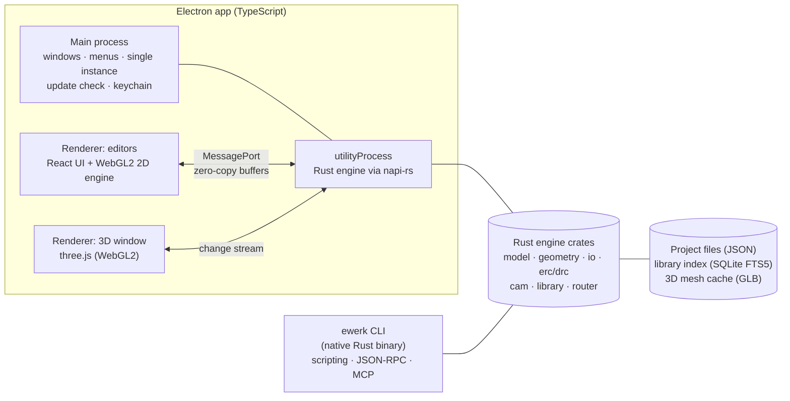

# ElectronicWerk Roadmap

> **Status:** v0.3 (2026-11-07). M0 is complete (release v0.1.0); M1 is next.
> This roadmap is a living document. It **must** be updated with every feature
> (requirement D5). Every change to it is listed in the
> [roadmap changelog](#13-roadmap-changelog).

---

## Table of contents

1. [Vision](#1-vision)
2. [Guiding principles](#2-guiding-principles)
3. [Project concept](#3-project-concept)
4. [Architecture](#4-architecture)
5. [Quality gates and Definition of Done](#5-quality-gates-and-definition-of-done)
6. [Performance budgets](#6-performance-budgets)
7. [Releases and packaging](#7-releases-and-packaging)
8. [Milestone overview](#8-milestone-overview)
9. [Milestone details](#9-milestone-details)
10. [File format matrix](#10-file-format-matrix)
11. [Requirements traceability](#11-requirements-traceability)
12. [Risks, open decisions and deferred items](#12-risks-open-decisions-and-deferred-items)
13. [Roadmap changelog](#13-roadmap-changelog)

---

## 1. Vision

ElectronicWerk is an open-source ECAD suite (MIT license) for beginners and
advanced hobbyists. It takes inspiration from the workflow and feature set of
Altium Designer, KiCad, DipTrace and Eagle, but everything is written from
scratch: no copied code, assets or file formats.

It covers the whole path from idea to manufactured board:

- **Project:** one project holds schematics, PCB, libraries, rules and outputs
  (as in Altium Designer and KiCad).
- **Design:** schematic, symbol, footprint and layout editors, plus a live 3D view.
- **Verify:** ERC, DRC and a design-rule system.
- **Manufacture:** Gerber X2, Excellon, BOM, pick-and-place, PDF, STEP and more.
- **Library:** a unified base library, online part search, deduplication.
- **Collaborate:** projects saved straight to GitHub.
- **Automate:** a full CLI, so scripts and AI agents can create schematics and
  boards from a terminal.
- **Assemble:** an interactive assembly assistant.

## 2. Guiding principles

| #   | Principle                       | What it means in practice                                                                                                  |
| --- | ------------------------------- | -------------------------------------------------------------------------------------------------------------------------- |
| 1   | **Performance is a feature**    | Measurable budgets (section 6) checked by benchmarks in CI. A regression fails the build.                                  |
| 2   | **Never lose work**             | Crash-isolated engine, autosave journal, crash recovery, atomic saves.                                                     |
| 3   | **Usability is mandatory**      | Beginner-friendly defaults, guided workflows, command palette, consistent shortcuts, undo for everything, contextual help. |
| 4   | **One engine, many front-ends** | Every action is an engine command. GUI, CLI, AI/MCP and tests all use the same API, so CLI parity comes for free.          |
| 5   | **Open, git-friendly formats**  | Text-based, deterministic and diff-friendly files with a schema version and automatic migrations.                          |
| 6   | **Quality from day one**        | 100 % lint-clean, tests on Windows/macOS/Linux, and documentation with screenshots for every feature.                      |
| 7   | **Privacy**                     | Anonymized docs and examples, credentials in the OS keychain, no telemetry.                                                |
| 8   | **Extensible**                  | Modular Rust crates and a versioned command API, ready for plugins after 1.0.                                              |

## 3. Project concept

As in Altium Designer and KiCad, **everything belongs to a project**. A project
is a folder with a manifest file and typed documents:

```text
MyBoard/
├── MyBoard.ewproj            # Project manifest: metadata, document list, settings, variables
├── schematics/
│   ├── root.ewsch            # Top sheet (hierarchical design)
│   └── power.ewsch           # Sub-sheets, multi-sheet and hierarchical
├── pcb/
│   └── MyBoard.ewpcb         # Board: stack-up, placement, routing, zones
├── rules/
│   └── design.ewrules        # Net classes, clearances, rule queries
├── library/                  # Project library (symbols, footprints, 3D, components)
├── outputs/
│   ├── fabrication.ewout     # Output job: Gerber, drill, BOM, CPL, PDF, STEP …
│   └── generated/            # Generated files (git-ignored by default)
└── .ewerk/                   # Local state: autosave journal, caches (never committed)
```

- **Project tree panel** (like Altium's _Projects_ panel): schematics, PCB,
  libraries, rules, output jobs, generated files and git status in one tree.
- **Project-wide data:** net classes, parameters and text variables (for
  example `${PROJECT_NAME}` and `${REVISION}` in title blocks), annotation,
  cross-probing, and engineering change orders (schematic ↔ PCB sync).
- **New-project wizard:** name, location (**local** or **GitHub**, see M11),
  template (for example _Empty_, _2-layer 100×100 mm_, _Arduino-style shield_)
  and board defaults.
- **Imported projects** (KiCad, netlists) always become a new native project.
  The original files are never changed.
- **Future-proof:** the manifest holds a list of documents, so later releases
  can add several boards per project, variants and harness documents without a
  format break.
- **Archive and copy:** _Save as_, _Save copy_ and _Archive project (.zip)_.

## 4. Architecture

> Proposed here and recorded as **ADR-0001** in M0. Architecture Decision
> Records live in `docs/adr/`.



| Layer                   | Technology                        | Responsibility                                                                                                                                                    |
| ----------------------- | --------------------------------- | ----------------------------------------------------------------------------------------------------------------------------------------------------------------- |
| Desktop shell           | Electron, TypeScript              | Windows (including a detachable 3D window), menus, single-instance lock, secure storage (`safeStorage`), update check. Closing the window quits the app cleanly.  |
| UI                      | React, TypeScript, Vite           | Panels, dialogs, property inspectors, command palette, i18n (German/English). Runs in a sandboxed renderer with `contextIsolation` and without `nodeIntegration`. |
| 2D rendering            | Custom WebGL2 engine (TypeScript) | Instanced rendering, layer compositing, level of detail, viewport culling, SDF text. Shared by all 2D editors.                                                    |
| 3D rendering            | three.js (WebGL2)                 | Board and component meshes, live updates from the engine change stream.                                                                                           |
| Engine                  | Rust workspace                    | Data model, commands, undo/redo, geometry, import/export, ERC/DRC, CAM, library, router. Multi-threaded (rayon). Runs in a crash-isolated `utilityProcess`.       |
| CLI                     | Rust binary `ewerk`               | Same engine crates. Batch commands, JSON-RPC server and MCP server for AI agents.                                                                                 |
| C++ (only where needed) | OpenCASCADE                       | STEP tessellation (first through the `occt-import-js` WASM build, later natively) and STEP assembly export.                                                       |
| Storage                 | JSON, SQLite FTS5, GLB            | Deterministic project files, a fast library search index, a cached 3D mesh per model.                                                                             |

### Core data model decisions

- Coordinates are integer **nanometres** (`i64`). There are no rounding errors
  and no size limits that matter.
- Every object has a stable **UUID**. Diffs and git merges stay readable.
- Every edit is a **transaction** (command pattern). This gives undo/redo,
  autosave journaling and change sets.
- Change sets are **streamed** to every view (2D editors, 3D window, panels).
  This is what makes the live 3D view and cross-probing possible.
- The file format has a **schema version** and migrations, so newer releases
  always open older projects.

## 5. Quality gates and Definition of Done

### Lint: 100 %, zero warnings (T2)

| Area         | Tools and settings                                                                                                                             |
| ------------ | ---------------------------------------------------------------------------------------------------------------------------------------------- |
| TypeScript   | `tsc` in strict mode with all strict flags; ESLint (`typescript-eslint` _strict-type-checked_ + _stylistic_) with `--max-warnings 0`; Prettier |
| Suppressions | `eslint-comments/require-description`: no unexplained `eslint-disable`                                                                         |
| i18n         | A check for hard-coded UI strings, plus a key-parity test between German and English                                                           |
| CSS          | Stylelint                                                                                                                                      |
| Rust         | `rustfmt`; `clippy` with `-D warnings` and `clippy::pedantic`; `cargo-deny` (licenses, advisories, duplicate dependencies)                     |
| Docs         | markdownlint, link checker                                                                                                                     |
| CI           | actionlint for workflows                                                                                                                       |
| Commits      | commitlint (Conventional Commits). The changelog and release notes are generated from these.                                                   |
| Local        | lefthook pre-commit hooks run the same checks                                                                                                  |

### Tests

| Level        | Tools                          | Scope                                                                               |
| ------------ | ------------------------------ | ----------------------------------------------------------------------------------- |
| Unit         | `cargo test`, proptest, Vitest | Engine crates, UI logic, i18n, update checker                                       |
| Integration  | Vitest + engine                | IPC bridge, commands, importer → model → exporter                                   |
| Golden files | `cargo test` + snapshots       | Importers and exporters (Gerber, Excellon, BOM …) compared against reference output |
| End-to-end   | Playwright for Electron        | Real UI workflows on Windows, macOS and Linux                                       |
| Performance  | criterion, Playwright traces   | The budgets in section 6. A regression of more than 10 % fails CI.                  |

Coverage targets: engine ≥ 90 % lines, UI logic ≥ 80 % lines.

### Definition of Done (for every feature)

1. Implemented as an engine command, with a CLI command where it makes sense.
2. Unit, integration and E2E tests are green on Windows, macOS and Linux.
3. 100 % lint-clean, with no new suppressions.
4. All UI strings exist in German and English.
5. A **documentation page** with screenshots (generated automatically from
   anonymized demo projects) and examples.
6. CHANGELOG entry and **roadmap update**.
7. Tested by the agent, and by the maintainer where needed, then commit, CI
   and release (D3).

## 6. Performance budgets

Reference designs are generated synthetically, so they are reproducible and
anonymous:

| Name   | Size                                                       |
| ------ | ---------------------------------------------------------- |
| **S**  | 50 parts, 2 layers                                         |
| **M**  | 500 parts, 4 layers                                        |
| **L**  | 5,000 parts, 10,000 nets, 200,000 track segments, 8 layers |
| **XL** | 20,000 parts (stress test)                                 |

| Metric                                            | Budget        |
| ------------------------------------------------- | ------------- |
| Pan/zoom frame rate (L, mid-range integrated GPU) | ≥ 60 fps      |
| Input to visual feedback (hover, drag, route)     | < 16 ms       |
| App start until the start screen                  | < 2 s         |
| Open project (L) / save project (L)               | < 3 s / < 1 s |
| Incremental DRC after an edit (L)                 | < 100 ms      |
| Full DRC (L)                                      | < 10 s        |
| 3D update after a layout edit                     | < 250 ms      |
| 3D frame rate with all component models (L)       | ≥ 30 fps      |
| Memory (L)                                        | < 1.5 GB      |

## 7. Releases and packaging

- **Versioning:** SemVer, with `0.x` until 1.0. Every tested feature produces a
  release (D3). Release notes come from the CHANGELOG.
- **Automated** through GitHub Actions (build → test → package → publish), with
  a `SHA256SUMS` file for every release.
- **Unsigned builds** (open source): the docs explain how to open the app
  despite macOS Gatekeeper and Windows SmartScreen.
- **In-app update notice** (T7): the app compares its version against GitHub
  Releases and shows the release notes. Users can _skip this version_ or open
  the download page. It never installs anything on its own.

| Platform | Packages                                                                                              | Architectures                                 |
| -------- | ----------------------------------------------------------------------------------------------------- | --------------------------------------------- |
| Windows  | NSIS installer, portable `.exe`                                                                       | x64, arm64                                    |
| macOS    | `.dmg`, `.zip`                                                                                        | Universal, Apple Silicon (arm64), Intel (x64) |
| Linux    | AppImage, `.deb` (Ubuntu, Mint), `.rpm` (Fedora), `.pacman` (Arch, CachyOS), Snap, Flatpak, `.tar.gz` | x64, arm64                                    |

## 8. Milestone overview

**Effort unit:** 1 session (S) ≈ 4 hours of focused agent work, including
implementation, tests, documentation and CI. These estimates cover the agent's
own work only. Maintainer test cycles and feedback come on top. Status values:
⬜ planned · 🟦 in progress · ✅ done.

| ID  | Milestone                                             | Release | Requirements      | Effort          | Status |
| --- | ----------------------------------------------------- | ------- | ----------------- | --------------- | ------ |
| M0  | Foundation and delivery pipeline                      | v0.1.0  | T1, T2, T7, D1–D5 | 6–8 S           | ✅     |
| M1  | Project system, data model, native file format        | v0.2.0  | F3, T3, T6        | 6–8 S           | ⬜     |
| M2  | 2D rendering engine and read-only viewer              | v0.3.0  | T3, T4, T5        | 7–10 S          | ⬜     |
| M3  | KiCad import (projects and libraries), netlist import | v0.4.0  | F3                | 6–9 S           | ⬜     |
| M4  | Unified base library and library manager              | v0.5.0  | F2                | 5–8 S           | ⬜     |
| M5  | Schematic editor and ERC                              | v0.6.0  | F4, F10           | 12–18 S         | ⬜     |
| M6  | Symbol editor and footprint editor                    | v0.7.0  | F5, F6            | 8–12 S          | ⬜     |
| M7  | Layout editor, DRC, rules, schematic ↔ PCB sync       | v0.8.0  | F7, F10           | 16–24 S         | ⬜     |
| M8  | Manufacturing outputs and output jobs                 | v0.9.0  | F10               | 7–10 S          | ⬜     |
| M9  | Live 3D view and STEP export                          | v0.10.0 | F8                | 7–10 S          | ⬜     |
| M10 | Online component search and provider accounts         | v0.11.0 | F1                | 6–9 S           | ⬜     |
| M11 | GitHub integration                                    | v0.12.0 | F9                | 4–6 S           | ⬜     |
| M12 | CLI and AI automation (complete)                      | v0.13.0 | F12               | 4–6 S           | ⬜     |
| M13 | Assembly assistant and extras                         | v0.14.0 | F11               | 4–6 S           | ⬜     |
| M14 | Interoperability: further open formats                | v0.15.0 | F3                | 5–8 S           | ⬜     |
| M15 | Advanced layout                                       | v0.16.0 | F7                | 12–20 S         | ⬜     |
| M16 | Hardening, UX audit, final docs and videos            | v1.0.0  | T3–T5, D1         | 6–10 S          | ⬜     |
|     | **Total to v1.0**                                     |         |                   | **≈ 120–180 S** |        |

**Stages:**

- After **M3**: KiCad projects can be opened and viewed.
- After **M8** (≈ 75–105 S): the full workflow schematic → layout → Gerber
  works.
- **M16**: v1.0.0.

Expected code size by v1.0: about 150,000–250,000 lines (Rust + TypeScript,
including tests).

## 9. Milestone details

### M0 — Foundation and delivery pipeline (v0.1.0, 6–8 S)

**Goal:** an empty but complete, secure and tested app shell, built and
released automatically for every platform.

- Monorepo: `crates/` (Rust engine, CLI, napi bridge), `apps/desktop`
  (Electron), `packages/` (UI, i18n, protocol types), `docs/` (documentation
  site), `assets/icon/`, `tests/e2e/`, `fixtures/` (synthetic and anonymized).
- Electron shell with secure defaults (`contextIsolation`, `sandbox`, no
  `nodeIntegration`, strict CSP, navigation and permission lock). Single
  instance; closing the window quits the app on every OS.
- Rust engine in a `utilityProcess` through napi-rs, a typed RPC over
  MessagePort, and crash detection and restart. The `ewerk` CLI skeleton
  (`--version`, `info`).
- App shell UI: start screen (new/open/recent), settings (language, theme,
  updates), status bar, command palette skeleton, light and dark themes.
- i18n: German and English, defaulting to the system language and switchable
  at runtime.
- Project icon as an SVG master. A script generates PNG, ICO and ICNS, and the
  icon is used for the window, Dock/taskbar, installer, favicon, README, docs
  and release page.
- Update check (T7): GitHub Releases API, version comparison, release notes in
  a dialog, a _Skip this version_ checkbox, _Remind me later_, _Open download
  page_. Works offline without errors.
- All lint gates (section 5) and the test stack (Vitest, `cargo test`,
  Playwright for Electron) on a CI matrix for Windows, macOS and Linux.
- Release workflow for every package in section 7, with a smoke test of the
  packaged app.
- Documentation site (VitePress on GitHub Pages) with an automated screenshot
  pipeline (Playwright). First pages: Installation (per OS, including the
  unsigned-app notes), Getting started, Settings, Language, Updates.
- Repository files: README, CHANGELOG, CONTRIBUTING, LICENSE, ADR-0001
  (architecture), issue and PR templates.

**Progress (completed 2026-11-07):**

- [x] Monorepo with Rust workspace (`ew-core`, `ew-cli`, `ew-node`) and the
      Electron app (`apps/desktop`)
- [x] Secure Electron shell: sandbox, context isolation, CSP, `app://`
      scheme, IPC sender checks, single instance, window close quits the app
- [x] Rust engine in a crash-isolated `utilityProcess` with automatic restart
      and a direct MessagePort channel (ADR-0001)
- [x] `ewerk` CLI (`info`, `methods`, `call`)
- [x] Start screen, status bar, settings dialog (language, appearance,
      updates), command palette
- [x] German and English UI with a type-checked key parity and a lint rule
      against hard-coded UI text
- [x] Lint gates with zero warnings, plus cargo-deny and actionlint in CI
- [x] Test stack: Rust, Vitest, Playwright for Electron; CI on
      Windows/macOS/Linux
- [x] Project icon (SVG master and generated formats)
- [x] Update check with release notes and "skip this version"
- [x] Release workflow for every package (native runners for Windows x64/arm64,
      macOS and Linux x64/arm64; smoke test of every packaged app)
- [x] Documentation site with automated screenshots
      (<https://ujap1994.github.io/ElectronicWerk/>)
- [x] Release v0.1.0

**Acceptance:** v0.1.0 is published with every package. The app starts, the
language switches, the update notice works, E2E tests are green on all three
operating systems, and the docs site is online.

### M1 — Project system, data model, native file format (v0.2.0, 6–8 S)

- Engine data model: project, documents, sheets (hierarchical), symbols,
  components, nets, footprints, pads, board stack-up, layers, tracks, vias,
  zones, texts, parameters and variables.
- Project concept as in section 3: manifest, document list, project tree
  panel, new-project wizard (local; GitHub follows in M11), templates.
- Transactions and command system: undo/redo (unlimited, with memory limits),
  change-set streaming, autosave journal, crash recovery, atomic saves.
- Native JSON format with deterministic, sorted output, a schema version and a
  migration framework.
- Generator for synthetic reference designs (S/M/L/XL) and the performance
  benchmark harness.
- CLI: `ewerk project new|info|validate`.

**Acceptance:** projects can be created, saved, reopened and archived. A kill
test proves crash recovery. A round-trip property test covers saving and
loading.

### M2 — 2D rendering engine and read-only viewer (v0.3.0, 7–10 S)

- WebGL2 engine: instanced primitives (lines, arcs, polygons, pads, vias),
  layer compositing with colours and opacity, grid, SDF text, level of detail
  and culling.
- Interaction basics: smooth pan and zoom (mouse, trackpad, keyboard), hover,
  selection (click, box, lasso), hit-testing with a spatial index (R-tree).
- Layer panel, property inspector (read-only) and the project tree connected
  to the viewer.
- Synthetic L/XL boards prove the budgets in section 6.

**Acceptance:** an L design pans and zooms at ≥ 60 fps. The benchmarks run in
CI.

### M3 — KiCad import and netlist import (v0.4.0, 6–9 S)

- Fast S-expression parser (Rust, streaming) for the current KiCad 10 format,
  plus older format versions as far as practical.
- Import of symbols (`.kicad_sym`, `.kicad_symdir`), footprints
  (`.kicad_mod`, `.pretty`), schematics (hierarchical, multi-sheet), PCB
  (`.kicad_pcb`, inner layers, zones, vias, rules), project files
  (`.kicad_pro`, `.kicad_dru`, library tables) and 3D model references.
- **Import as a new project:** a KiCad project becomes a native ElectronicWerk
  project with a detailed import report (warnings and anything that could not
  be mapped).
- Netlist import: KiCad netlist (`.net`), generic CSV/XML netlists. Other open
  netlist formats are added if needed.
- Tests: synthetic KiCad fixtures in CI, plus regression tests against private
  sample projects that only run locally and never enter the repository.

**Acceptance:** a 4-layer, multi-sheet KiCad 10 project imports without errors
and matches the original visually and electrically (net comparison).

### M4 — Unified base library and library manager (v0.5.0, 5–8 S)

- Library index: SQLite with FTS5 full-text search (name, value, package,
  manufacturer part number, keywords, parameters).
- Ingest of the KiCad base libraries (symbols, footprints, 3D models).
- **Deduplication engine (independent of the source):** a normalized geometry
  hash for footprints (pads, shapes, sizes, after normalizing origin, rotation
  and units), a pin signature for symbols, and a content hash and bounding box
  for 3D models. Results are classed as exact duplicate, near duplicate (within
  tolerance) or alias. A merge report and a review UI handle uncertain cases.
  New sources (online parts in M10, further formats in M14) plug into the same
  engine.
- 3D mesh cache: STEP/WRL → GLB, tessellated once and then reused.
- Library manager UI: a virtualized list (more than 100,000 entries), filters,
  and previews of the symbol, footprint and 3D model.
- License handling: the KiCad libraries are CC-BY-SA 4.0 with a design
  exception. The merged library is published separately under that license,
  with attribution. The app code stays MIT.
- Distribution of large data (more than 3 GB of 3D models): library packs
  downloaded on demand instead of bundled in the installer.

**Acceptance:** a search over the whole base library answers in < 50 ms. The
dedup report is reproducible.

### M5 — Schematic editor and ERC (v0.6.0, 12–18 S)

- Place, move, rotate and mirror components; wires, buses, junctions, net
  labels, global and hierarchical labels, power ports, no-connect flags.
- Hierarchical sheets and multi-sheet designs, sheet symbols and ports.
- Annotation (automatic and manual), component parameters, text variables,
  title blocks.
- Smart editing: drag with rubber-banding, auto-junctions, copy and paste
  across sheets, find and replace, net highlighting.
- ERC: pin type matrix (configurable), unconnected pins, conflicting drivers,
  missing power and more. Results panel with zoom-to-issue.
- Beginner aids: guided first schematic, tooltips, a snap and grid assistant.
- Exports: PDF/SVG print, netlist, BOM (preliminary).

### M6 — Symbol editor and footprint editor (v0.7.0, 8–12 S)

- Symbol editor: pins (types, styles, numbering), graphics, multi-unit parts,
  alternate body styles, a pin table with bulk editing.
- Footprint editor: pads (SMD/THT, all shapes, custom pads), courtyard,
  silkscreen, fabrication layer, 3D model assignment and alignment.
- **Footprint wizards** (IPC-7351-style generators): chip, SOIC/QFP/QFN, BGA,
  headers.
- Component editor: links symbol + footprint + 3D model + parameters +
  supplier data into a library component.
- Library checks (similar to the KiCad library conventions): consistency of
  pins, pads and courtyard.

### M7 — Layout editor, DRC, rules, schematic ↔ PCB sync (v0.8.0, 16–24 S)

- Board setup: outline (drawn), layer stack-up editor (copper, dielectric,
  thickness), board presets.
- Forward and back annotation (ECO dialog), cross-probing and cross-selection
  between schematic and PCB.
- Placement: ratsnest, alignment and distribution tools, rooms (later),
  component grid.
- Interactive routing (walkaround), vias, track width from rules,
  multi-segment editing, track drag.
- Copper zones and pours (thermal relief, priorities, islands), keep-out areas.
- **Design rules:** net classes, clearance, width, via and annular ring rules,
  a rule editor with a query language. Rules are stored in the project.
- **DRC**, online (incremental, < 100 ms) and batch (full): clearance, shorts,
  unrouted nets, annular ring, holes, silkscreen over pads, courtyard overlap
  and more.
- DXF import for board outlines and mechanical layers.

### M8 — Manufacturing outputs and output jobs (v0.9.0, 7–10 S)

- Gerber X2 (with attributes), Excellon drill files, drill map.
- BOM (CSV/XLSX/HTML, configurable columns, grouping), pick-and-place (CPL).
- PDF and SVG prints of schematic and layout, assembly drawings.
- IPC-D-356 netlist, IPC-2581. ODB++ if the effort is justified.
- **Output jobs** (like Altium OutJobs): one click generates every
  manufacturing file, with presets for common board houses.
- Built-in Gerber viewer to check the generated output.
- Verification: generated Gerbers are tested against reference renders (golden
  files).

### M9 — Live 3D view and STEP export (v0.10.0, 7–10 S)

- Board body from the outline (holes, cut-outs, thickness from the stack-up),
  copper, mask, silkscreen and paste as textures or geometry.
- Component models from the mesh cache, with placement offsets from the
  footprints.
- **Live update** from the engine change stream: a component moved in the
  layout moves in 3D within < 250 ms.
- Optional detachable **3D window** (second monitor), synchronized selection.
- Camera presets, section views, measurements, screenshot export.
- STEP export of the whole board assembly (native OpenCASCADE), VRML/GLB
  export.

### M10 — Online component search and provider accounts (v0.11.0, 6–9 S)

- Provider framework with one adapter per provider and an account setup in
  Settings. Credentials are stored in the OS keychain.
- Integration in two tiers, depending on what each provider allows:
  1. **Official APIs** where they exist (for example Nexar/Octopart, Digi-Key,
     Mouser, LCSC/JLCPCB, and SnapEDA with an API key).
  2. **Embedded provider window**: the user signs in to the provider (for
     example Ultra Librarian or SnapEDA) in an isolated, sandboxed browser
     window. Downloaded KiCad-format ZIP files are imported automatically and
     run through deduplication (M4).
- Unified search results with symbol, footprint and 3D preview, datasheet,
  pricing and stock where the API offers them.
- The terms of use of every provider are reviewed before its adapter is built.

### M11 — GitHub integration (v0.12.0, 4–6 S)

- Sign in with the OAuth device flow (no secret stored in the app), or with a
  personal access token as an alternative. The token is stored in the OS
  keychain.
- New-project wizard: **Local** or **GitHub**. With GitHub, the user picks an
  existing repository or ElectronicWerk creates a new one (public or private,
  with `.gitignore`, README and project structure).
- Clone/open from GitHub, commit and push from the project tree, pull, branch
  switch, history view, and a visual diff of schematic and PCB revisions
  (later).

### M12 — CLI and AI automation, complete (v0.13.0, 4–6 S)

The CLI grows with every milestone. This milestone completes it.

- Every engine command is available in the CLI: create projects, place
  components, connect nets, place footprints, route, run ERC/DRC, generate
  outputs.
- JSON input and output for scripting, batch scripts, and exit codes for CI.
- JSON-RPC server mode and an **MCP server**, so AI agents can use
  ElectronicWerk directly.
- A documented scripting cookbook with examples.

### M13 — Assembly assistant and extras (v0.14.0, 4–6 S)

- **Assembly assistant:** an interactive view (board view + BOM) that
  highlights the next components to place, groups by value and side, tracks
  progress with checkboxes, and has a large-display mode for the workbench.
  Progress is saved in the project.
- Further extras such as a panelization helper, design statistics and a
  documentation generator. Collaboration features are scoped after the core is
  stable (F11).

### M14 — Interoperability: further open formats (v0.15.0, 5–8 S)

- KiCad export (round trip), so users are never locked in.
- Specctra DSN export and SES import (external autorouters such as
  Freerouting).
- Gerber/Excellon import as a reference layer.
- Eagle XML import (`.sch`/`.brd`/`.lbr`, publicly documented DTD) as a new
  native project, with an import report, and Eagle libraries routed into the
  deduplication engine (M4).

### M15 — Advanced layout (v0.16.0, 12–20 S)

- Interactive router with push-and-shove, differential pairs, length tuning
  and matching (meanders), teardrops.
- Via stitching and shielding, back drilling (if needed), blind and buried
  vias.
- Design variants, rooms and channels for repeated blocks.

### M16 — Hardening, UX audit, final docs and videos (v1.0.0, 6–10 S)

- Performance and stability campaign on XL designs, fuzzing of every importer,
  a memory-leak audit.
- UX audit: a walkthrough of every workflow, consistency of shortcuts and
  menus, accessibility (keyboard navigation, contrast, scaling).
- Final, complete documentation, plus screen videos showing the main workflows
  (D1).
- Release v1.0.0.

## 10. File format matrix

| Format                                                                         | Import               | Export             | Milestone      |
| ------------------------------------------------------------------------------ | -------------------- | ------------------ | -------------- |
| ElectronicWerk native (`.ewproj`, `.ewsch`, `.ewpcb`, `.ewrules`, `.ewout`, …) | ✔                    | ✔                  | M1             |
| KiCad project, schematic, PCB, rules, library tables                           | ✔                    | (M14)              | M3 / M14       |
| KiCad symbols and footprints                                                   | ✔                    | ✔                  | M3 / M6        |
| KiCad netlist (`.net`), generic CSV/XML netlist                                | ✔                    | ✔                  | M3 / M5        |
| STEP / WRL 3D models                                                           | ✔                    | ✔ (board assembly) | M4 / M9        |
| DXF (outline, mechanical layers)                                               | ✔                    | ✔                  | M7 / M8        |
| Gerber X2, Excellon                                                            | ✔ (reference/viewer) | ✔                  | M8 / M14       |
| BOM (CSV/XLSX/HTML), pick-and-place                                            | —                    | ✔                  | M8             |
| PDF / SVG                                                                      | —                    | ✔                  | M5 / M8        |
| IPC-D-356, IPC-2581                                                            | —                    | ✔                  | M8             |
| ODB++                                                                          | —                    | ✔ (if justified)   | M8             |
| Specctra DSN / SES                                                             | SES                  | DSN                | M14            |
| Eagle XML (`.sch`, `.brd`, `.lbr`)                                             | ✔                    | —                  | M14            |
| DipTrace (undocumented binary format)                                          | ⏸ deferred           | —                  | see section 12 |

## 11. Requirements traceability

| Req.  | Summary                                                                                          | Milestone(s)                                   |
| ----- | ------------------------------------------------------------------------------------------------ | ---------------------------------------------- |
| P1    | Open-source alternative (MIT) modelled on Altium/KiCad/DipTrace/Eagle, everything self-developed | whole project                                  |
| P2    | Target audience: beginners and advanced hobbyists                                                | M5–M7, M16 (UX)                                |
| F1    | Online part search (SnapEDA, Ultra Librarian, …) with accounts in Settings                       | M10                                            |
| F2    | Deduplicate and merge base libraries                                                             | M4 (KiCad; other sources pluggable)            |
| F3    | Import projects cleanly, edit them, save them as own projects                                    | M1, M3 (KiCad), M14 (Eagle and others)         |
| F4    | Schematic editor                                                                                 | M5                                             |
| F5    | Symbol/component editor                                                                          | M6                                             |
| F6    | Footprint editor                                                                                 | M6                                             |
| F7    | Layout editor                                                                                    | M7, M15                                        |
| F8    | Live 3D view, optionally in its own window                                                       | M9                                             |
| F9    | GitHub integration (local or GitHub when creating a project)                                     | M1 (wizard), M11                               |
| F10   | ERC, DRC, rules and standard features                                                            | M5, M7, M8                                     |
| F11   | Assembly assistant and extras                                                                    | M13                                            |
| F12   | CLI for scripts and AI agents                                                                    | M0–M12 (grows), M12 (complete)                 |
| T1    | Electron + Rust/TypeScript/C++                                                                   | M0 (ADR-0001)                                  |
| T2    | 100 % lint from the start                                                                        | M0 onwards                                     |
| T3/T4 | Efficiency and performance at any design size                                                    | section 6, every milestone                     |
| T5    | Absolute usability                                                                               | every milestone, M16 audit                     |
| T6    | Future-proof and extensible                                                                      | sections 2–4                                   |
| T7    | Update notice with release notes and "skip version"                                              | M0                                             |
| D1    | Detailed docs with screenshots for every feature; videos at the end                              | every milestone, M16                           |
| D2    | Everything anonymized                                                                            | every milestone (synthetic demo projects only) |
| D3    | Commit, CI and release after every tested feature                                                | every milestone                                |
| D4    | Packages for Windows, macOS and Linux                                                            | M0 (section 7)                                 |
| D5    | Detailed roadmap, updated with every feature                                                     | this document                                  |

## 12. Risks, open decisions and deferred items

### Risks

| Risk                                                      | Impact           | Mitigation                                                                                 |
| --------------------------------------------------------- | ---------------- | ------------------------------------------------------------------------------------------ |
| Size of the overall scope (Altium/KiCad class)            | Schedule         | Strict milestone order and a usable release at every stage                                 |
| Rendering performance on large designs                    | T3/T4            | Custom WebGL2 engine, benchmarks in CI from M2                                             |
| STEP tessellation (OpenCASCADE is a large C++ dependency) | Build complexity | WASM build first, native later; a GLB cache                                                |
| 3D model volume (more than 3 GB)                          | Installer size   | Library packs downloaded on demand                                                         |
| Online provider APIs and terms of use                     | F1 scope         | Official APIs plus an embedded login window; review the terms first                        |
| Unsigned builds                                           | Install friction | Clear installation docs for every OS                                                       |
| Interactive router quality (push-and-shove)               | F7               | Walkaround router in M7; push-and-shove in M15; external autorouter through Specctra (M14) |

### Open decisions

- **Merged base library:** published as a separate repository/pack under
  CC-BY-SA 4.0, decided in M4.

### Deferred items

- **DipTrace import (projects and libraries):** deferred. DipTrace stores
  schematics, boards and libraries in an undocumented binary format.
  Re-evaluate after v1.0, for example through DipTrace's own export formats.
  The deduplication engine (M4) is source-independent, so DipTrace libraries
  can be added later without redesign.
- **Post-1.0 candidates:** SPICE simulation (ngspice), real-time collaboration,
  a plugin API, multi-board/harness design, signal-integrity helpers.

## 13. Roadmap changelog

| Date       | Version    | Change                                                                                                                                                                      |
| ---------- | ---------- | --------------------------------------------------------------------------------------------------------------------------------------------------------------------------- |
| 2026-11-07 | Draft v0.1 | Initial roadmap. DipTrace import deferred; import limited to KiCad and open standard formats; Altium/KiCad-style project concept added.                                     |
| 2026-11-07 | v0.2       | Approved by the maintainer: milestone order (import and viewer before the editors) confirmed, Eagle XML import added to M14, project renamed to ElectronicWerk. M0 started. |
| 2026-11-07 | v0.3       | M0 complete: v0.1.0 released with every package and the documentation site. The command palette and the update notice were delivered as part of M0.                         |
