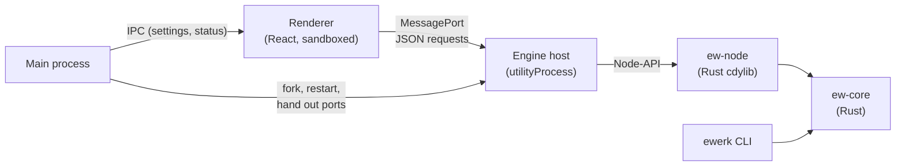

# ADR-0001: Application architecture

- **Status:** accepted
- **Date:** 2026-11-07
- **Milestone:** M0

## Context

ElectronicWerk must handle large schematics and boards without a drop in
performance (requirements T3 and T4). It must stay stable when one part fails,
and it must be fully scriptable from a terminal (F12). The maintainer chose
Electron with Rust, TypeScript and, where needed, C++ (T1).

## Decision

### Processes

| Process                | Technology                            | Responsibility                                                                    |
| ---------------------- | ------------------------------------- | --------------------------------------------------------------------------------- |
| Main                   | Electron, TypeScript                  | Windows, menus, settings, single-instance lock, security policy, engine lifecycle |
| Renderer               | React, TypeScript (sandboxed)         | User interface; no Node.js access, only the typed `window.ew` preload API         |
| Engine host            | Electron `utilityProcess` + Rust      | Loads the native engine (`crates/ew-node`) and serves requests over MessagePorts  |
| CLI (outside Electron) | Rust binary `ewerk` (`crates/ew-cli`) | Same engine crates, for scripts, CI and AI agents                                 |

### One engine API for every client

Every engine operation is a **method** with a name (`engine.info`, later for
example `project.open` or `pcb.addTrack`) that takes JSON parameters
(`ew_core::rpc::dispatch`). The desktop app, the CLI (`ewerk call <method>
<params>`), automated tests and later an MCP server all use exactly this API. A
feature that exists in the engine is automatically scriptable (F12).

### Crash isolation

The native engine runs in its own `utilityProcess`. If it crashes, the main
process notices the exit, starts a new engine (at most 3 restarts within
60 s), and hands every window a fresh MessagePort. The user interface stays
open and shows a notice. A missing or broken native library is reported as a
fatal error and does not cause a restart loop.

### Direct renderer ↔ engine channel

The main process creates a `MessageChannelMain` per window and passes one end
to the engine host and the other through the preload script into the page.
Requests then travel straight from the UI to the engine without going through
the main process. Large binary data (geometry buffers) can later be
transferred without copying.

### Security

- `contextIsolation`, `sandbox` (enforced globally with `app.enableSandbox()`)
  and no `nodeIntegration`.
- The production UI is served from the custom `app://bundle` scheme with a
  strict Content Security Policy instead of `file://`.
- Every IPC handler checks that the sender frame comes from our own origin.
- New windows, webviews, navigation to other origins and all permission
  requests are denied. External links open in the browser only if they match
  an allow-list.

### Other decisions

- **Single instance:** a second launch focuses the existing window and exits.
- **Window close:** closing the last window quits the app on every platform,
  including macOS.
- **i18n:** English is the source dictionary. German must have exactly the same
  keys (checked by the type system and tests). A custom ESLint rule forbids
  hard-coded UI text in JSX.
- **Settings:** a JSON file in the user data folder. It is validated on load
  and on every change, and written atomically (temporary file, then rename).
- **Coordinates (from M1):** integer nanometres (`i64`) in the engine.

## Consequences

- The Rust engine must be built for each platform and architecture. CI does
  this, and for macOS a universal binary is merged with `lipo`.
- JSON over MessagePort is fast enough for commands. Bulk geometry will use
  transferable binary buffers (introduced with the renderer in M2).
- The CLI and the desktop app can never drift apart, because they share the
  engine crates.
